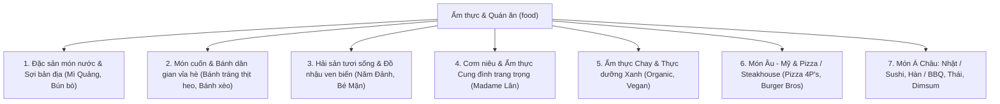
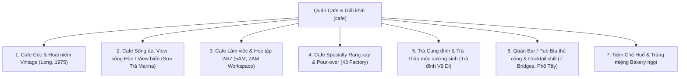
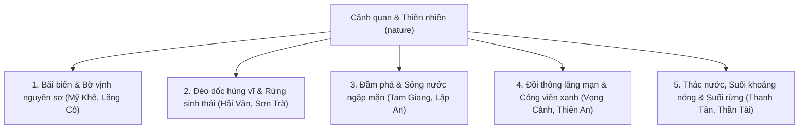
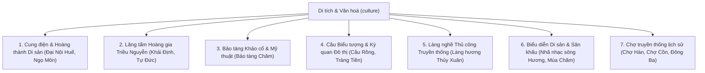
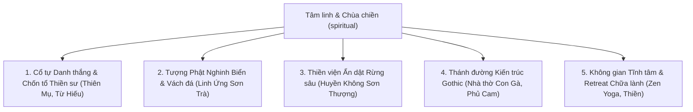
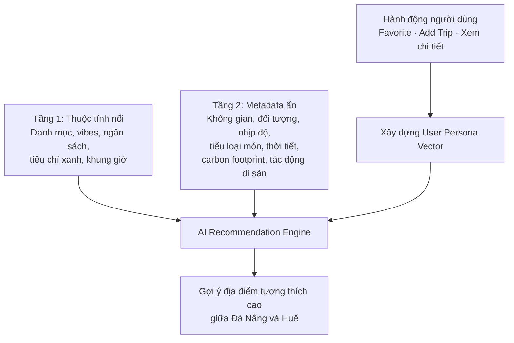

<USER_REQUEST>
# BẢNG PHÂN LOẠI CHI TIẾT POI (ĐÀ NẴNG - HUẾ) DÀNH CHO HUẤN LUYỆN AI & GỢI Ý THÔNG MINH (BẢN TOÀN DIỆN V2)

> **Dự án**: GreenTrip AI Platform
> **Phạm vi địa lý**: Đà Nẵng & Thừa Thiên Huế
> **Phiên bản V2**: Bổ sung đầy đủ Ẩm thực quốc tế (Pizza, Sushi, BBQ, Món Âu-Mỹ), Nightlife/Bar, Suối khoáng nóng sinh thái, Nghệ thuật biểu diễn di sản và Chợ truyền thống.

---

## I. GIẢI PHÁP CHO CÁC MÓN QUỐC TẾ (PIZZA, SUSHI, MÓN TRUNG, ÂU - MỸ...)

Bạn đặt câu hỏi rất sắc bén: *Nếu người dùng tại Đà Nẵng/Huế muốn ăn Pizza, Sushi, Món Hàn, Steakhouse Âu - Mỹ hay Đồ ăn nhanh thì phân loại như thế nào để không bị thiếu mà cũng không làm rối hệ thống?*

### Cách tiếp cận chuẩn quốc tế (Mindtrip / Google Places Architecture):

Không nên tạo 10 nhánh con riêng lẻ cho từng món (sẽ làm vỡ taxonomy). Thay vào đó, áp dụng **Kiến trúc phân loại Đa chiều (Multi-Faceted Architecture)**:

1. **Nhánh con (Format/Loại hình trải nghiệm)**: Chia thành các cụm trải nghiệm ẩm thực lớn.
2. **Trường phái ẩm thực (`cuisine_origin`)**: Một bộ lọc đa chọn linh hoạt (`Vietnamese`, `Italian/Pizza`, `Japanese/Sushi`, `Korean/BBQ`, `Western/American`, `Chinese/Dimsum`, `Thai`, `French/Bistro`).
3. **Thẻ vi mô cho AI (`micro_tags`)**: `craft_pizza`, `wood_fired_oven`, `wagyu_steak`, `omakase`, `craft_beer_pairing`.

> **Ví dụ thực tế trong dự án GreenTrip**:
>
> - **Pizza 4P’s (Hoàng Văn Thụ, ĐN)**:
>   - `category`: `'food'`
>   - `sub_category`: `'international_western'` (Ẩm thực Âu - Mỹ & Quốc tế)
>   - `cuisine`: `'italian_pizza'`
>   - `ai_tags`: `['artisan_pizza', 'housemade_cheese', 'zero_waste_concept', 'farm_to_table', 'date_night', 'family_friendly']` $\rightarrow$ *Đặc biệt: 4P's là nhà hàng chuẩn "Eco/Zero-waste" cực kỳ khớp định vị GreenTrip!*
> - **Burger Bros (Phố Tây An Thượng, ĐN)**:
>   - `category`: `'food'` | `sub_category`: `'international_western'` | `cuisine`: `'american_burger'`
>   - `ai_tags`: `['craft_burger', 'expat_favorite', 'beach_casual', 'quick_bites']`
> - **Dasushi / Akataiyo (ĐN & Huế)**:
>   - `category`: `'food'` | `sub_category`: `'asian_specialties'` | `cuisine`: `'japanese_sushi'`
>   - `ai_tags`: `['fresh_sashimi', 'sushi_rolls', 'japanese_ambiance', 'clean_eating']`

---

## II. RÀ SOÁT TOÀN DIỆN: 5 NHÓM ĐÃ THỰC SỰ ĐẦY ĐỦ CHƯA?

Sau khi đối chiếu với dữ liệu thực tế tại Đà Nẵng & Huế và các ảnh bộ lọc của Mindtrip, chúng tôi bổ sung thêm **6 mảnh ghép còn thiếu** để bao quát 100% bản đồ du lịch miền Trung:


| Nhóm                                      | Điểm bổ sung mới trong Bản V2                                                                                                                                         | Giá trị thực tế tại Đà Nẵng – Huế                                                                                                |
| :------------------------------------------- | :--------------------------------------------------------------------------------------------------------------------------------------------------------------------------- | :------------------------------------------------------------------------------------------------------------------------------------------- |
| **1. Ẩm thực (`food`)**                  | • Bổ sung **Ẩm thực Quốc tế & Âu - Mỹ** (`international_western`)• Bổ sung **Món Á Châu: Nhật, Hàn, Thái, Trung** (`asian_specialties`)                    | Phục vụ khu phố Tây An Thượng, khách quốc tế và giới trẻ thích Pizza, Sushi, BBQ Hàn Quốc, Steakhouse.                      |
| **2. Cafe & Đồ uống (`cafe`)**          | • Bổ sung **Quán Bar / Pub bia thủ công & Cocktail Lounge** (`nightlife_bars_pubs`)• Bổ sung **Tiệm Tráng miệng, Chè cung đình & Bakery** (`desserts_bakery`) | Phố đêm Bạch Đằng, Phố đi bộ Huế (Phạm Ngũ Lão/Chu Văn An), Bia thủ công 7 Bridges ngắm Cầu Rồng, Quán Chè hẻm Huế. |
| **3. Cảnh quan Thiên nhiên (`nature`)** | • Bổ sung **Suối khoáng nóng, Thác nước & Du lịch Suối rừng** (`waterfalls_hotsprings`)                                                                         | Trải nghiệm Eco-Wellness đặc sắc: Suối khoáng nóng Alba Thanh Tân (Huế), Núi Thần Tài, Suối Mơ, Hòa Phú Thành (ĐN).     |
| **4. Di tích & Văn hóa (`culture`)**    | • Bổ sung **Biểu diễn Nghệ thuật Di sản & Sân khấu** (`performing_arts_heritage`)• Bổ sung **Chợ truyền thống trăm tuổi** (`historic_markets`)             | Nhã nhạc Cung đình trên sông Hương, Múa Chăm, Chợ Cồn, Chợ Hàn (ĐN), Chợ Đông Ba (Huế).                                 |
| **5. Tâm linh & Chùa (`spiritual`)**     | • Bổ sung **Không gian Thiền định & Retreat Chữa lành** (`zen_retreats_healing`)                                                                                   | Các trung tâm thiền chuông xoay, yoga rừng thông, retreat thanh lọc thân tâm ở chân đèo Hải Vân và xứ Huế.               |

---

## III. MA TRẬN PHÂN LOẠI TOÀN DIỆN V2 (7 NHÁNH CHO MỖI NHÓM)

### 1. NHÓM ẨM THỰC & QUÁN ĂN (`food` - 🍴)




| Nhánh con (`sub_category`)                                     | Ví dụ tiêu biểu tại ĐN - Huế                                                  | Bộ lọc hiển thị (Tầng 1)                                | Metadata ẩn cho AI (Tầng 2)                                                                  |
| :---------------------------------------------------------------- | :------------------------------------------------------------------------------------- | :------------------------------------------------------------- | :----------------------------------------------------------------------------------------------- |
| **1. Đặc sản món nước & sợi** (`traditional_noodles`)    | Bún bò Bà Rơi, Mì Quảng Bà Vị, Bún chả cá Bà Lữ, Bánh canh Mẹ Kéo    | Món sợi, Món nước, Bản địa, `$`                      | `rich_broth`, `signature_local`, `spicy_hué`, `quick_dining`, `heritage_recipe`               |
| **2. Món cuốn & Bánh vỉa hè** (`street_bites_rolls`)       | Bánh tráng cuốn thịt heo Đại Lộc, Bánh xèo Bà Dưỡng, Bánh ép Chị Huệ | Ăn vặt, Vỉa hè, Đi nhóm, `$` - `$$`                    | `finger_food`, `mam_nem_dna`, `crispy`, `cheap_eats`, `sharing_portion`, `afternoon_snack`     |
| **3. Hải sản tươi sống** (`coastal_seafood`)               | Hải sản Năm Đảnh, Bé Mặn, Quán Duyên (Đầm Lập An)                        | Hải sản, Gió biển, Nhóm bạn/Gia đình, `$$`           | `live_tank`, `ocean_view`, `noisy_vibrant`, `late_night`, `craft_beer`, `fresh_catch`          |
| **4. Cơm niêu & Cung đình** (`heritage_fine_dining`)        | Madame Lân, Không Gian Xưa, Cung Đình Huế                                      | Trang trọng, Không gian đẹp, Máy lạnh, `$$$`           | `fine_dining`, `royal_presentation`, `family_gathering`, `ac_comfort`, `cultural_architecture` |
| **5. Ẩm thực Chay & Xanh** (`green_vegetarian`)               | An Lạc Tâm, Chay Thiền Tâm (Huế), Bếp Chay Karma                               | Thuần chay, Thực dưỡng, Tốt sức khỏe, Tiêu chí Xanh | `plant_based`, `buddhist_vegan`, `organic_farm`, `zen_quiet`, `low_carbon`, `detox`            |
| **6. Món Âu - Mỹ & Pizza/Burger** (`western_international`)  | Pizza 4P's, Burger Bros, Olivia's Prime Steakhouse                                   | Pizza/Burger/Steak, Quốc tế, Hẹn hò, `$$` - `$$$`        | `wood_fired_pizza`, `craft_burger`, `wine_pairing`, `expat_area`, `zero_waste_farming`         |
| **7. Món Á: Nhật, Hàn, Thái, Trung** (`asian_specialties`) | Dasushi, Akataiyo, Gogi House, Dimsum Tiến Phát                                    | Sushi/Sashimi, BBQ nướng, Lẩu Thái, `$$`                 | `fresh_sashimi`, `korean_table_bbq`, `dimsum_baskets`, `clean_flavor`, `youth_favorite`        |

---

### 2. NHÓM QUÁN CAFE & GIẢI KHÁT (`cafe` - ☕)




| Nhánh con (`sub_category`)                                      | Ví dụ tiêu biểu tại ĐN - Huế                                   | Bộ lọc hiển thị (Tầng 1)                             | Metadata ẩn cho AI (Tầng 2)                                                                 |
| :----------------------------------------------------------------- | :---------------------------------------------------------------------- | :---------------------------------------------------------- | :---------------------------------------------------------------------------------------------- |
| **1. Cafe Cóc & Vintage** (`retro_street_cafe`)                 | Cà phê Long (ĐN), Cafe 1975 (Huế), Cà phê Muối Trương Định | Cà phê phin, Vỉa hè, Mộc mạc, Sáng sớm, `$`       | `phin_coffee`, `salted_coffee`, `street_life`, `morning_ritual`, `smoker_friendly_outdoor`    |
| **2. Cafe View đẹp & Sống ảo** (`scenic_view_cafe`)          | Sơn Trà Marina, Lu Coffee ven sông Hàn, Hazy Sunset Lounge        | View sông/biển, Sống ảo, Hoàng hôn, `$$`            | `instagrammable`, `river_breeze`, `golden_hour`, `sunset_view`, `trendy_drink`                |
| **3. Cafe Làm việc 24/7** (`workspace_study_cafe`)             | 5AM Coffee Workspace, 2AM Coffee, The Local Beans                     | Yên tĩnh, Ổ điện, Wifi mạnh, Máy lạnh, Mở muộn  | `digital_nomad`, `laptop_friendly`, `ergonomic_chair`, `deep_work`, `24_hours`, `silent_zone` |
| **4. Cafe Specialty Thủ công** (`specialty_roastery`)          | 43 Factory Coffee Roaster, Puna Coffee, Tan Specialty                 | Cà phê hạt tuyển chọn, Pha Pour-over, `$$$`          | `single_origin`, `cold_brew`, `v60`, `scandinavian_minimalism`, `artisan_barista`             |
| **5. Trà Thảo mộc & Cung đình** (`royal_herbal_tea`)        | Trà đình Vũ Di, Trà Cung Đình Đức Phượng                   | Trà thảo mộc, Thanh tịnh, Truyền thống, `$$`        | `herbal_wellness`, `tea_ceremony`, `zen_mind`, `stress_relief`, `ceramic_art`                 |
| **6. Bar / Pub Bia thủ công & Lounge** (`nightlife_bars_pubs`) | 7 Bridges Brewing Co., On The Radio Bar, Century Pub                  | Bia thủ công, Nhạc Acoustic, Chill đêm, `$$` - `$$$` | `craft_beer`, `live_music`, `cocktail_mixology`, `nightlife`, `social_hub`, `bridge_view`     |
| **7. Tiệm Chè & Tráng miệng ngọt** (`desserts_bakery`)      | Chè Hẻm Hùng Vương (Huế), Tiệm Bánh BonPas, Kem Bơ           | Chè truyền thống, Bánh ngọt, Tráng miệng, `$`      | `sweet_tooth`, `hue_royal_sweet_soup`, `after_dinner_treat`, `comfort_dessert`                |

---

### 3. NHÓM CẢNH QUAN & THIÊN NHIÊN (`nature` - 🌲)




| Nhánh con (`sub_category`)                                        | Ví dụ tiêu biểu tại ĐN - Huế                                      | Bộ lọc hiển thị (Tầng 1)                                     | Metadata ẩn cho AI (Tầng 2)                                                              |
| :------------------------------------------------------------------- | :------------------------------------------------------------------------- | :------------------------------------------------------------------ | :------------------------------------------------------------------------------------------- |
| **1. Bãi biển & Bờ vịnh** (`beach_coastline`)                  | Bãi biển Mỹ Khê, Bãi Rạng, Biển Lăng Cô, Thuận An              | Tắm biển, Đi dạo cát, Bình minh/Chiều mát                 | `swimming`, `fine_sand`, `water_sports`, `family_friendly`, `beach_jogging`                |
| **2. Đèo dốc & Bán đảo** (`mountain_pass_peninsula`)         | Đỉnh Đèo Hải Vân, Bán đảo Sơn Trà (Đỉnh Bàn Cờ, Cây đa) | Cung đường phượt, Ngắm toàn cảnh, Không khí trong lành | `winding_road`, `panoramic_ocean_view`, `wildlife_vooc`, `cloud_hunting`, `cool_climate`   |
| **3. Đầm phá & Rừng ngập mặn** (`wetland_lagoon_rivers`)     | Phá Tam Giang, Đầm Lập An, Rừng ngập mặn Rú Chá                 | Đi thuyền/SUP, Hoàng hôn rực rỡ, Chụp ảnh phong cảnh     | `brackish_lagoon`, `sunset_spot`, `fisherman_culture`, `sup_paddling`, `vast_waterscape`   |
| **4. Đồi thông & Công viên** (`pine_hills_parks`)             | Đồi Vọng Cảnh (Huế), Đồi Thiên An, Công viên 29/3              | Dã ngoại Picnic, Đi bộ thư thái, Rợp bóng mát            | `pine_trees`, `romantic_viewpoint`, `peaceful_breeze`, `picnic_mat`, `cycling_path`        |
| **5. Suối khoáng nóng & Thác rừng** (`waterfalls_hotsprings`) | Alba Thanh Tân (Huế), Núi Thần Tài, Suối Mơ, Hòa Phú Thành     | Tắm khoáng nóng Onsen, Trượt thác, Tắm suối mát          | `hot_mineral_springs`, `eco_wellness`, `natural_stream`, `waterfall_adventure`, `mud_bath` |

---

### 4. NHÓM DI TÍCH LỊCH SỬ & VĂN HOÁ (`culture` - 🏛️)




| Nhánh con (`sub_category`)                                          | Ví dụ tiêu biểu tại ĐN - Huế                                   | Bộ lọc hiển thị (Tầng 1)                                        | Metadata ẩn cho AI (Tầng 2)                                                             |
| :--------------------------------------------------------------------- | :---------------------------------------------------------------------- | :--------------------------------------------------------------------- | :------------------------------------------------------------------------------------------ |
| **1. Cung điện & Hoàng thành** (`imperial_citadel`)              | Đại Nội Kinh thành Huế, Kỳ Đài, Điện Thái Hòa             | Di sản UNESCO, Hoàng cung, Lịch sử triều Nguyễn                | `unesco_world_heritage`, `oriental_palace`, `dynasty_history`, `educational_tour`         |
| **2. Lăng tẩm Hoàng gia** (`royal_mausoleums`)                    | Lăng Khải Định, Lăng Tự Đức, Lăng Minh Mạng                 | Kiến trúc độc bản, Chụp ảnh cổ phục, Phong thủy            | `royal_tomb`, `mosaic_art`, `feng_shui`, `vietnamese_costume`, `melancholic_architecture` |
| **3. Bảo tàng & Mỹ thuật** (`museums_galleries`)                 | Bảo tàng Điêu khắc Chăm (ĐN), Cổ vật Cung đình Huế        | Trong nhà (Mưa đi tốt), Hiện vật cổ quý giá, Máy lạnh     | `champa_sculptures`, `ancient_artifacts`, `indoor_rain_friendly`, `curated_art`           |
| **4. Cầu Biểu tượng & Đô thị** (`iconic_urban_landmarks`)     | Cầu Rồng phun lửa, Cầu Tràng Tiền, Cầu Vàng Bà Nà           | Biểu tượng thành phố, Check-in đêm, Miễn phí vé            | `city_landmark`, `fire_breathing_show`, `night_lights`, `architectural_feat`              |
| **5. Làng nghề truyền thống** (`craft_villages`)                 | Làng hương Thủy Xuân, Làng đá Non Nước, Làng nón Tây Hồ | Trải nghiệm làm thử (DIY), Quà lưu niệm, Chụp ảnh đẹp     | `artisan_craft`, `incense_sticks`, `sustainable_community`, `handmade_souvenir`           |
| **6. Biểu diễn Nghệ thuật Di sản** (`performing_arts_heritage`) | Ca Huế trên sông Hương, Trình diễn Nhã nhạc Cung đình      | Thưởng thức nghệ thuật, Đi thuyền rồng, Buổi tối           | `unesco_intangible_heritage`, `court_music`, `traditional_instruments`, `dragon_boat`     |
| **7. Chợ truyền thống lịch sử** (`historic_markets`)            | Chợ Hàn, Chợ Cồn (ĐN), Chợ Đông Ba (Huế)                     | Mua sắm đặc sản, Nét sống bản địa, Thiên đường ăn vặt | `local_trade`, `cultural_melting_pot`, `souvenir_bargaining`, `bustling_sensory`          |

---

### 5. NHÓM TÂM LINH & CHÙA CHIỀN (`spiritual` - 🪷)




| Nhánh con (`sub_category`)                                        | Ví dụ tiêu biểu tại ĐN - Huế                                  | Bộ lọc hiển thị (Tầng 1)                                         | Metadata ẩn cho AI (Tầng 2)                                                           |
| :------------------------------------------------------------------- | :--------------------------------------------------------------------- | :---------------------------------------------------------------------- | :---------------------------------------------------------------------------------------- |
| **1. Cổ tự & Chốn tổ thiền** (`historic_zen_temples`)         | Chùa Thiên Mụ, Chùa Từ Hiếu (Làng Mai), Chùa Tam Thai        | Cổ tự trăm năm, Chuông chùa, Thanh tịnh, Kín đáo            | `zen_buddhism`, `mindfulness`, `temple_bell`, `thich_nhat_hanh_root`, `vegetarian_calm` |
| **2. Tượng Phật & Vách núi** (`grand_mountain_ocean_temples`) | Chùa Linh Ứng Bãi Bụt (Tượng 67m), Động Huyền Không        | Tượng Phật kỳ vĩ, Ngắm toàn cảnh vịnh biển                  | `giant_buddha`, `ocean_facing`, `limestone_cave`, `spiritual_energy`, `scenic_temple`   |
| **3. Thiền viện rừng sâu** (`forest_hermitage_monasteries`)    | Chùa Huyền Không Sơn Thượng, Thiền viện Trúc Lâm Bạch Mã | Rời xa phố thị, Thiền định chữa lành, Tuyệt đối yên tĩnh | `forest_monastery`, `theravada`, `lake_reflection`, `deep_silence`, `digital_detox`     |
| **4. Thánh đường Gothic** (`cathedrals_heritage_churches`)     | Nhà thờ Chính tòa Đà Nẵng (Nhà thờ Con Gà hồng), Phủ Cam | Kiến trúc Gothic Châu Âu, Lễ Chúa nhật, Tôn nghiêm           | `gothic_cathedral`, `stained_glass`, `french_architecture`, `pink_church`, `downtown`   |
| **5. Không gian Retreat Chữa lành** (`zen_retreats_healing`)    | Không gian Thiền Chuông xoay, Lớp Yoga vườn thiền             | Thiền chuông, Thải độc tâm trí, Lối sống tỉnh thức         | `sound_bath_meditation`, `mindful_yoga`, `holistic_healing`, `eco_wellness_retreat`     |

---

## IV. BẢNG TỔNG HỢP MATRIX DỮ LIỆU ĐỂ DEV & TRAIN AI

Dưới đây là cách mô hình dữ liệu sẽ lưu trữ trong file `src/data/pois.ts` và Database PostgreSQL:

```typescript
// 1. Năm nhóm cốt lõi
export type CoreCategory = 'food' | 'cafe' | 'nature' | 'culture' | 'spiritual';

// 2. Trường phái ẩm thực (Giải quyết triệt để Pizza, Sushi, Món Á, Món Âu)
export type CuisineType = 
  | 'vietnamese_local'       // Mì Quảng, Bún bò, Hải sản
  | 'italian_pizza'          // Pizza 4P's, Pasta
  | 'japanese_sushi'         // Sushi, Sashimi, Ramen
  | 'korean_bbq'             // Nướng Hàn Quốc, K-Food
  | 'western_steak_burger'   // Burger Bros, Steakhouse
  | 'chinese_dimsum'         // Dimsum, Vịt quay
  | 'thai_spicy'             // Tomyum, Somtam
  | 'plant_based_vegan';     // Thuần chay thực dưỡng

// 3. Schema POI hoàn chỉnh phục vụ AI & Giao diện
export interface SmartPoi {
  id: string;
  name: string;
  category: CoreCategory;
  sub_category: string;
  city: 'Đà Nẵng' | 'Huế';
  lat: number;
  lng: number;
  address: string;
  image: string;
  gallery: string[];
  description: string;

  // TẦNG 1: HIỂN THỊ TRÊN UI ĐỂ NGƯỜI DÙNG TỰ CHỌN
  cuisine?: CuisineType;                          // Chỉ áp dụng cho 'food'
  budget_tier: '$' | '$$' | '$$$' | 'free';       // $: <50k | $$: 50k-200k | $$$: >200k | free: miễn phí
  vibes: string[];                                // ['Ngoài trời', 'Hoài niệm', 'Yên bình', 'Sống ảo', 'Náo nhiệt']
  best_time: ('morning' | 'afternoon' | 'evening' | 'night')[];
  eco_features: string[];                         // ['Đi bộ/xe đạp', 'Organic', 'Trạm sạc xe điện']

  // TẦNG 2: ẨN HOÀN TOÀN - DÀNH RIÊNG CHO AI EMBEDDINGS & TÍNH TOÁN RECOMMENDATION
  ai_metadata: {
    dna_tags: string[];           // Các tag sâu ngữ nghĩa (vd: 'wood_fired_pizza', 'artisan_cheese')
    target_crowd: ('solo' | 'couples' | 'family' | 'friends' | 'nomad')[];
    noise_pace: 'peaceful_zen' | 'chill_slow' | 'bustling_vibrant';
    rainy_day_friendly: boolean;  // Rất hữu ích vào mùa mưa miền Trung
    carbon_footprint_score: number; // 1 -> 100
    heritage_impact_score: number;  // 1 -> 100
  };
}
```

---

## V. MÔ HÌNH TƯƠNG TÁC VÀ AI RECOMMENDATION ENGINE

Phần này tổng hợp nội dung thể hiện trong sơ đồ `mermaid-diagram.svg`, đặt cạnh taxonomy POI để tạo thành một tài liệu Markdown thống nhất. Sơ đồ phân biệt thuộc tính hiển thị trên giao diện (Tầng 1) với metadata ngữ nghĩa dành cho AI (Tầng 2), sau đó mô tả cách hành động của người dùng có thể hỗ trợ xây dựng hồ sơ sở thích và gợi ý địa điểm.

### 5.1. Tầng 1: Thuộc tính nổi dành cho bộ lọc UI

Các thuộc tính được sơ đồ liệt kê:

1. **Danh mục chính:** 5 nhóm `food`, `cafe`, `nature`, `culture`, `spiritual`.
2. **Không khí chung (vibes):** Ngoài trời, Hoài niệm, Nhộn nhịp, Thư giãn.
3. **Mức ngân sách:** `$`, `$$`, `$$$`.
4. **Tiêu chí xanh:** Đi bộ/xe đạp, Thuần chay, Trạm sạc.
5. **Khung giờ:** Sáng, Chiều, Tối.

Đây là nhóm thuộc tính dành cho người dùng nhìn thấy và lựa chọn trực tiếp trên giao diện.

### 5.2. Hành động của người dùng

Sơ đồ thể hiện ba hành động:

- **Thả tim (Favorite).**
- **Thêm vào chuyến đi (Add Trip).**
- **Xem chi tiết (Click/View duration).**

Các hành động này là tín hiệu tương tác có thể dùng làm đầu vào xây dựng hồ sơ sở thích. Sơ đồ không quy định cụ thể công thức trọng số hoặc cách cập nhật hồ sơ.

### 5.3. Tầng 2: Thuộc tính ẩn dành cho AI

Sơ đồ liệt kê các nhóm metadata sau:

- **Không gian:** vintage, minimalist, view sông, view biển, sân vườn.
- **Đối tượng:** đi một mình, cặp đôi, gia đình trẻ, nhóm bạn trẻ.
- **Âm thanh và nhịp độ:** yên tĩnh đọc sách, sống động náo nhiệt.
- **Tiểu loại món:** bún bò, mì Quảng, hải sản tươi sống, cafe muối.
- **Thời tiết:** ngày mưa đi được, chỉ đi ngày nắng đẹp.
- **Chỉ số tác động:** điểm footprint carbon, đóng góp văn hóa làng nghề bản địa.

Các thuộc tính này bổ sung ngữ nghĩa cho POI ngoài các bộ lọc giao diện. Chúng có liên hệ với các trường trong `SmartPoi`, chẳng hạn `ai_metadata.dna_tags`, `target_crowd`, `noise_pace`, `rainy_day_friendly`, `carbon_footprint_score` và `heritage_impact_score`. Tên gọi và giá trị cụ thể giữa sơ đồ và TypeScript không hoàn toàn đồng nhất; cần chuẩn hóa khi triển khai.

### 5.4. Luồng khái niệm của hệ thống gợi ý



**Diễn giải:** Người dùng lọc POI bằng các thuộc tính hiển thị và tương tác với địa điểm. Metadata ẩn bổ sung thông tin ngữ nghĩa để AI đánh giá mức độ phù hợp. Sơ đồ đề xuất xây dựng `User Persona Vector` từ tín hiệu tương tác, sau đó đưa thông tin hồ sơ người dùng và metadata POI vào `AI Recommendation Engine` để gợi ý địa điểm tương thích giữa Đà Nẵng và Huế.

Sơ đồ nguồn không mô tả thuật toán embedding, cách tính điểm tương thích, cách huấn luyện, hay quy tắc xếp hạng. Những nội dung đó cần được thiết kế và kiểm chứng riêng, không nên xem là đã được xác định trong tài liệu nguồn.

### 5.5. Đối chiếu sơ đồ với schema `SmartPoi`


| Nội dung trong sơ đồ          | Trường/schema liên quan trong tài liệu taxonomy | Ghi chú                                                                                                                |
| ----------------------------------- | ------------------------------------------------------ | ------------------------------------------------------------------------------------------------------------------------- |
| Danh mục chính (5 nhóm)        | `category: CoreCategory`                             | Trùng khớp 5 nhóm cốt lõi.                                                                                         |
| Không khí chung / Vibes         | `vibes: string[]` và `ai_metadata.noise_pace`       | `vibes` hiển thị; `noise_pace` mô tả nhịp độ ở tầng AI.                                                        |
| Mức ngân sách                  | `budget_tier`                                        | Schema có `$`, `$$`, `$$$`, `free`; sơ đồ chỉ liệt kê `$`, `$$`, `$$$`.                                          |
| Tiêu chí xanh                   | `eco_features: string[]`                             | Ví dụ: đi bộ/xe đạp, thuần chay, trạm sạc.                                                                     |
| Khung giờ                        | `best_time`                                          | Schema gồm `morning`, `afternoon`, `evening`, `night`; sơ đồ dùng Sáng, Chiều, Tối.                             |
| Không gian                       | `vibes` và/hoặc `ai_metadata.dna_tags`             | Cần quy định rõ thuộc tính nào dùng cho bộ lọc và thuộc tính nào dành riêng cho AI.                     |
| Đối tượng                     | `ai_metadata.target_crowd`                           | Schema gồm `solo`, `couples`, `family`, `friends`, `nomad`; sơ đồ nêu các nhóm người dùng bằng tiếng Việt. |
| Âm thanh & nhịp độ            | `ai_metadata.noise_pace`                             | Schema có `peaceful_zen`, `chill_slow`, `bustling_vibrant`.                                                            |
| Tiểu loại món                  | `sub_category`, `cuisine`, `ai_metadata.dna_tags`    | `cuisine` chỉ áp dụng cho nhóm `food` theo schema.                                                                  |
| Thời tiết                       | `ai_metadata.rainy_day_friendly`                     | Kiểu boolean, phù hợp biểu diễn có/không thân thiện với ngày mưa.                                           |
| Footprint carbon                  | `ai_metadata.carbon_footprint_score`                 | Điểm số 1–100 theo schema; ý nghĩa chiều cao/thấp cần được định nghĩa.                                   |
| Đóng góp văn hóa làng nghề | `ai_metadata.heritage_impact_score`                  | Điểm số 1–100 theo schema; cần định nghĩa phương pháp chấm điểm.                                          |
| User Persona Vector               | Chưa có trường trực tiếp trong `SmartPoi`      | Là hồ sơ người dùng riêng, không nên mặc định lưu như thuộc tính của POI.                              |
| Gợi ý địa điểm              | `AI Recommendation Engine`                           | Là chức năng hệ thống; tài liệu nguồn chưa chỉ định thuật toán cụ thể.                                  |

### 5.6. Lưu ý khi triển khai

1. **Giữ riêng hai tầng dữ liệu:** thuộc tính để người dùng lọc và metadata phục vụ xếp hạng AI có thể liên quan nhưng không nên mặc định là cùng một trường.
2. **Chuẩn hóa enum và tag:** thống nhất tên tiếng Anh dạng `snake_case`, định nghĩa từ điển giá trị hợp lệ và cách ánh xạ nhãn tiếng Việt trên UI.
3. **Không đồng nhất điểm số với số đo thực tế:** `carbon_footprint_score` và `heritage_impact_score` được khai báo là điểm 1–100; tài liệu nguồn chưa cung cấp công thức hoặc đơn vị đo.
4. **Tách hồ sơ người dùng khỏi POI:** `User Persona Vector` là khái niệm về sở thích người dùng; schema `SmartPoi` hiện mô tả địa điểm.
5. **Kiểm chứng dữ liệu địa điểm:** tên POI, địa chỉ, giá, giờ mở cửa, đặc tính xanh và các ví dụ minh họa cần được xác minh trước khi đưa vào dữ liệu sản phẩm hoặc dùng làm nhãn huấn luyện.
</USER_REQUEST>
<ADDITIONAL_METADATA>
The current local time is: 2026-10-25T22:53:42+07:00.

The user's current state is as follows:
Active Document: d:\GreenTrip-AI-Smart-Travel-Planner-for-Da-Nang-Hue-\docs\postman\GreenTrip_Local.postman_environment.json (LANGUAGE_JSON)
Cursor is on line: 1
Other open documents:
- d:\GreenTrip-AI-Smart-Travel-Planner-for-Da-Nang-Hue-\docs\postman\GreenTrip_Local.postman_environment.json (LANGUAGE_JSON)
- d:\GreenTrip-AI-Smart-Travel-Planner-for-Da-Nang-Hue-\backend\scripts\import_pois_supabase.py (LANGUAGE_PYTHON)
- d:\GreenTrip-AI-Smart-Travel-Planner-for-Da-Nang-Hue-\frontend\src\pages\LoginPage.tsx (LANGUAGE_TSX)
- d:\GreenTrip-AI-Smart-Travel-Planner-for-Da-Nang-Hue-\backend\scripts\format_pois_csv.py (LANGUAGE_PYTHON)
- d:\GreenTrip-AI-Smart-Travel-Planner-for-Da-Nang-Hue-\get_otp.py (LANGUAGE_PYTHON)
</ADDITIONAL_METADATA>