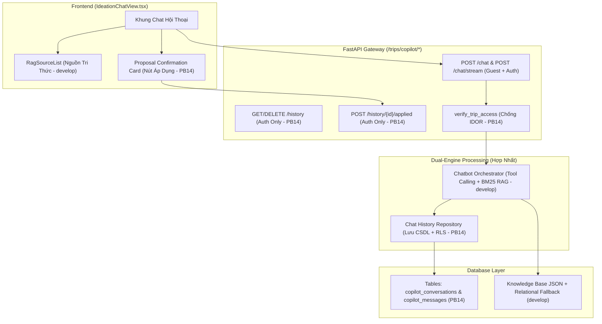

# BÁO CÁO KIỂM TOÁN & ĐỐI CHIẾU KỸ THUẬT TOÀN DIỆN
## CHATBOT GREENTRIP HIỆN TẠI VS. CÁC NHÁNH PHÁT TRIỂN CỦA THÀNH VIÊN KHÁC

- **Vai trò**: Senior Software Architect, AI Engineer & Git Code Auditor
- **Phương thức thực hiện**: **AUDIT READ-ONLY** (Không commit, không push, không merge, không checkout đổi nhánh, bảo toàn 100% working tree)
- **Thời điểm kiểm toán**: 24/11/2026
- **Nhánh làm việc hiện tại**: `develop` (HEAD: `c6a472b443722b76102b8a9a1ad41941999bbfea`)
- **Tài liệu xuất bản**: `docs/CHATBOT_BRANCH_COMPARISON_AUDIT.md`

---

## 1. TỔNG QUAN ĐIỀU HÀNH (EXECUTIVE SUMMARY)

Báo cáo này cung cấp kết quả kiểm toán kỹ thuật độc lập, khách quan giữa **Chatbot GreenTrip hiện tại trên nhánh `develop`** và **các nhánh phát triển của các thành viên khác trong nhóm**, trọng tâm là nhánh **`feature/#pb14_chatbot-security-and-history-upgrade`** cùng 4 nhánh liên quan (`feature/#pb19_hue-poi-data-enrichment`, `feature/mindtrip-landing-onboarding-ai`, `bugfix/recover-landing-planner-20261123`, `feature/#crawl-stays-data`).

### Kết Luận Cốt Lõi:
1. **Về Năng lực AI & Kiến trúc Chatbot**:
   - **Chatbot hiện tại (`develop`) vượt trội hoàn toàn về mặt AI, RAG và Khả năng Tối ưu hóa**: Đang vận hành kiến trúc 2 tầng (Tier-1: Orchestrator với 10 tools, BM25 RAG trích xuất nguồn, SSE streaming, multi-turn itinerary optimizer 2-Opt; Tier-2: Domain handlers fallback).
   - **Nhánh PB14 không có Orchestrator, không có Tool Calling, không có BM25 RAG**: PB14 được xây dựng trên nền tảng kiến trúc cũ (Sprint 1.x heuristic intent router với regex/keyword), hoàn toàn thiếu vắng các bước nhảy vọt của Sprint 2.1–2.9.
2. **Về Bảo mật Lịch sử & Kiểm soát Đề xuất (Ưu điểm lớn của PB14)**:
   - **Nhánh PB14 làm xuất sắc hơn `develop` ở 2 điểm kỹ thuật then chốt**:
     - **Lưu trữ CSDL & Phân lập Lịch sử Hội thoại**: Triển khai migration `015_create_copilot_chat_history.sql`, bảng `copilot_conversations` và `copilot_messages` với Supabase RLS policies (`auth.uid() = user_id`) và SQLite fallback.
     - **Cơ chế Xác nhận Đề xuất Lịch trình (Proposal Confirmation Workflow)**: Đề xuất thay đổi lịch trình không tự động ghi đè CSDL mà gắn nhãn `requires_confirmation: True`, `applied: False`, cung cấp API xác nhận (`POST .../applied`), chống duplicate apply (409) và tự động vô hiệu hóa đề xuất cũ khi có đề xuất mới (`superseded`).
     - **Bảo vệ IDOR cấp Chatbot**: Chặn người dùng khác chat hoặc đọc lịch sử chuyến đi của người khác bằng mã `403 Forbidden` (`verify_trip_access`).
3. **Cảnh báo Xung Đột Nghiêm Trọng (Critical Merge Hazard)**:
   - **TUYỆT ĐỐI KHÔNG MERGE TRỰC TIẾP NHÁNH PB14 VÀO DEVELOP**: Nếu thực hiện `git merge` thông thường, code của PB14 sẽ **ghi đè và xóa sổ hoàn toàn** module `app.orchestrator`, `app.rag`, `app.tools`, endpoint SSE streaming `/trips/copilot/chat/stream` và giao diện `RagSourceList.tsx`, kéo dự án thụt lùi về Sprint 1.x.
4. **Phương án Tích hợp Khuyến nghị**:
   - Áp dụng chiến lược **Selective Transplantation (Ghép chọn lọc)**: Giữ nguyên 100% động cơ AI Orchestrator + RAG của `develop`; chỉ trích xuất lớp lưu trữ `chat_history_repository.py`, migration `015`, và cơ chế `verify_trip_access` + Proposal Confirmation của PB14 tích hợp vào tầng Gateway của `develop`.

---

## 2. TỔNG QUAN CÁC NHÁNH GIT (GIT BRANCH OVERVIEW)

Bằng các lệnh truy vấn Git ref trực tiếp (`git ls-remote`, `git merge-base`, `git rev-list`, `git log`), trạng thái các nhánh được xác định chính xác như sau:

| Tên Nhánh Git | Ref Đầy Đủ | Commit Mới Nhất | Merge-Base với `develop` | Số Commit Ahead / Behind `develop` | Trạng Thái & Mục Đích Chính |
| :--- | :--- | :---: | :---: | :---: | :--- |
| **`develop` (Current)** | `refs/heads/develop` | `c6a472b` | `c6a472b` | 0 / 0 | Nhánh tích hợp chính; chứa Chatbot Sprint 2.1–2.9 (Orchestrator, RAG, 10 tools, 567 tests). |
| **`feature/#pb14_chatbot-security-and-history-upgrade`** | `origin/feature/#pb14_...` | `7bf9e73` | `c22ee3b` | 7 ahead / 27 behind | Nhánh nâng cấp bảo mật, CSDL chat history, IDOR check, và proposal confirmation. |
| **`feature/#pb19_hue-poi-data-enrichment`** | `origin/feature/#pb19_...` | `666fb0e` | `c6a472b` | 2 ahead / 0 behind | Nhánh bổ sung dữ liệu POI Huế (398 POIs ứng viên, 204 lưu trú ứng viên) và gói tour trang Home. |
| **`feature/mindtrip-landing-onboarding-ai`** | `origin/feature/mindtrip-...` | `1ece47a` | `3f99ab3` | 72 ahead / 41 behind | Nhánh giao diện Mindtrip cũ; chứa module trùng lặp `app.assistant` (nguy cơ xung đột cao). |
| **`bugfix/recover-landing-planner-20261123`** | `origin/bugfix/recover-...` | `1ece47a` | `3f99ab3` | 72 ahead / 41 behind | **Trỏ cùng commit `1ece47a` với nhánh trên** (bản sao phục hồi giao diện). |
| **`feature/#crawl-stays-data`** | `origin/feature/#crawl-...` | `51c5c3b` | `0a45740` | 3 ahead / 31 behind | Nhánh cào dữ liệu lưu trú Google Maps và pipeline làm sạch (không ảnh hưởng chatbot). |

---

## 3. KIẾN TRÚC CHATBOT HIỆN TẠI (CURRENT DEVELOP CHATBOT ARCHITECTURE)

### 3.1. Luồng Xử Lý Thực Tế (Execution Call Flow)
```
[User Message] 
       │
       ▼
[Frontend: IdeationChatView.tsx] 
       │  (Hỗ trợ cả Streaming SSE qua copilotService.streamCopilotChat
       │   lẫn Standard HTTP POST qua copilotService.sendCopilotChat)
       ▼
[API Gateway: POST /trips/copilot/chat hoặc /chat/stream]
       │
       ▼
[Orchestrator Policy: app.orchestrator.policy.decide_orchestration_plan]
       │  ├── Chặn Prompt Injection bằng Regex Guardrail
       │  └── Phân loại ý định: knowledge_rag, explanation, itinerary_cost_route, mutation...
       ▼
[Orchestrator: app.orchestrator.orchestrator.ChatbotOrchestrator]
       │
       ├──► [BM25 RAG: app.rag.service.get_rag_service] 
       │        └── Truy xuất knowledge_base.json -> Sinh snippets & citations
       │
       ├──► [Tool Registry: app.tools.registry.ToolRegistry (10 Whitelisted Tools)]
       │        ├── search_pois (app.tools.implementations)
       │        ├── get_poi_details
       │        ├── recommend_pois (Đa mục tiêu: Green, Cost, Preference)
       │        ├── get_poi_explanation (Relational Projection / Neo4j)
       │        ├── calculate_trip_cost (Budget tiers)
       │        ├── get_route_information (OSRM / Haversine detour)
       │        ├── get_carbon_estimate (Vietnam urban baseline)
       │        ├── rag_travel_knowledge
       │        ├── generate_itinerary (2-Opt optimizer + schedule constraints)
       │        └── update_itinerary (Mutation deltas)
       │
       ▼
[LLM Synthesizer / Local Fallback]
       ├── Mode 1: Google Gemini 2.5 Flash API (Function Calling + Token Streaming)
       └── Mode 2: Local Rule-based Synthesizers (Hoạt động offline khi mất mạng)
       │
       ▼
[Response Payload: CopilotChatResponse + Accordion RAG Sources]
       │
       ▼
[Frontend Render: IdeationChatView.tsx + RagSourceList.tsx]
```

### 3.2. Ưu Điểm Nổi Bật Của Chatbot Hiện Tại:
- **Độ tin cậy cao với 101/101 automated tests PASS (100%)**: Được kiểm thử đa tầng từ Unit test, Integration test, E2E test đến UAT 20 scenarios và Hallucination Benchmark 50 câu hỏi.
- **Minh bạch dữ liệu chống ảo giác (Anti-Hallucination)**: Nguồn trích dẫn RAG được hiển thị rõ ràng trên giao diện dưới dạng accordion trích đoạn văn bản di sản; các địa điểm thiếu giá được gắn cờ `missing_data`.
- **Khả năng tự hành ngoại tuyến tuyệt đối (Offline Resiliency)**: Khi ngắt toàn bộ Internet, CSDL tự chuyển SQLite `greentrip.db`, Knowledge Graph tự chuyển Relational Projection (32.86ms), định tuyến tự chuyển Haversine Detour (1.25 nội đô, 1.35 liên tỉnh) và câu trả lời tự sinh bằng Heuristic cục bộ trong ~7ms.

---

## 4. PHÂN TÍCH CHATBOT TRÊN NHÁNH PB14 (`feature/#pb14_...`)

### 4.1. Kiến Trúc Chatbot Của Nhánh PB14
Nhánh PB14 không đi theo hướng AI Orchestrator / Tool Calling của Sprint 2, mà tập trung nâng cấp hệ thống **Heuristic Intent Router cũ (Sprint 1.x)**:
- Điểm vào: `backend/app/trips/service.py:process_copilot_chat`.
- Sử dụng `classify_copilot_request_hybrid` (kết hợp Gemini NLU + Regex) để phân loại thành các intent rời rạc: `poi_search`, `culinary_guide`, `cafe_culture`, `travel_tips_budget`, `swap_meal_vegetarian`, `rainy_day_alternatives`, `night_eco_activities`, `late_schedule_adjust`.
- Mỗi intent chuyển tiếp đến một handler hàm Python chuyên biệt trong `backend/app/trips/handlers/*`.

### 4.2. Các Cải Tiến Đáng Giá Nhất Trên Nhánh PB14
1. **Lưu Trữ Lịch Sử Hội Thoại Xuống Cơ Sở Dữ Liệu (`chat_history_repository.py`)**:
   - Bổ sung migration `backend/migrations/015_create_copilot_chat_history.sql`.
   - Tạo hai bảng dữ liệu: `copilot_conversations` (quản lý phiên chat theo `user_id` và `trip_id`, lưu `trip_memory` và `active_constraints`) và `copilot_messages` (lưu từng tin nhắn của `user` và `assistant`, kèm `metadata` chi tiết).
   - Thiết lập đầy đủ **Supabase Row Level Security (RLS)**: `auth.uid() = user_id`, ngăn chặn triệt để nguy cơ đọc trộm tin nhắn từ client.
   - Hỗ trợ hàm tự khởi tạo bảng cục bộ `_ensure_chat_tables` khi chạy trên SQLite fallback.
2. **Kiểm Soát Quyền Sở Hữu & Chống IDOR (`verify_trip_access`)**:
   - Trước khi cho phép chat hoặc đọc lịch sử, kiểm tra quyền sở hữu: nếu `trip_id != 'ideation'` và thuộc về người dùng khác, hệ thống lập tức chặn với mã HTTP **`403 Forbidden`**.
3. **Quy Trình Xác Nhận Đề Xuất Lịch Trình (Proposal Confirmation Workflow)**:
   - Khi Copilot đề xuất thay đổi lịch trình (ví dụ: chuyển sang 2 đêm ĐN, 1 đêm Huế), CSDL lịch trình **chưa bị thay đổi ngay**.
   - Đề xuất được lưu vào metadata của tin nhắn với cờ `applied: False` và `requires_confirmation: True`.
   - Người dùng phải nhấn nút **"Áp dụng vào lịch trình"** trên giao diện, gọi endpoint `POST /trips/copilot/history/{message_id}/applied` để chính thức cập nhật.
   - Chặn xác nhận trùng lặp (`409 Conflict`) và tự động đánh dấu các đề xuất cũ là `superseded: True` khi người dùng yêu cầu đề xuất mới.
4. **Grounded POI Search Handler (`poi_search_handler.py`)**:
   - Thêm bộ lọc giá trần thông minh ("dưới 100k"), bộ lọc địa điểm tâm linh miễn phí ("chùa miễn phí") và nhận diện mốc tọa độ neo ở đuôi câu ("gần Cầu Rồng").

### 4.3. Các Thiếu Sót & Giới Hạn Của Nhánh PB14
1. **Hoàn toàn thiếu vắng AI Orchestrator & Tool Calling**: Không có khái niệm Tool Registry, không có Pydantic Tool Input/Output Schemas, không có khả năng tự động chọn công cụ linh hoạt theo ngữ cảnh của LLM.
2. **Không có RAG Tri Thức Du Lịch**: Không có BM25 retrieval, không có kho tri thức `knowledge_base.json`, không thể hiển thị nguồn tài liệu cho người dùng.
3. **Không có SSE Streaming**: Không hỗ trợ endpoint `/trips/copilot/chat/stream`, toàn bộ câu trả lời phải đợi sinh xong mới trả về một lần, gây cảm giác chậm chạp cho người dùng khi gọi LLM đám mây.
4. **Bắt Buộc Đăng Nhập Cứng Nhắc**: Router của PB14 đặt `current_user_id: str = Depends(get_current_user_id)` ngay tại endpoint `POST /trips/copilot/chat`. Điều này vô tình **chặn đứng khách vãng lai (Guest users)** không thể trải nghiệm chat thử nghiệm trên trang Explore hay Onboarding trước khi đăng ký tài khoản.

---

## 5. BẢNG SO SÁNH CHỨC NĂNG CHI TIẾT (FEATURE COMPARISON MATRIX)

| Tiêu Chí So Sánh | Chatbot Hiện Tại (`develop`) | Nhánh PB14 (`feature/#pb14_...`) | Nhận Xét & Đánh Giá Kiến Trúc |
| :--- | :---: | :---: | :--- |
| **Kiến trúc Chatbot** | **2-Tier**: Orchestrator + Domain Handlers Fallback | **1-Tier**: Heuristic Intent Handler Router | `develop` hiện đại, mở rộng tốt hơn theo chuẩn AI Agent. |
| **RAG (Retrieval-Augmented Generation)** | **CÓ THỰC TẾ** (`app/rag/service.py`) | **KHÔNG CÓ** | `develop` có trích xuất tri thức BM25 và nguồn trích dẫn. |
| **BM25 Retrieval** | **CÓ THỰC TẾ** (50+ curated chunks) | **KHÔNG CÓ** | `develop` độc quyền tính năng này. |
| **Tool Calling Framework** | **CÓ THỰC TẾ** (10 Pydantic tools) | **KHÔNG CÓ** | PB14 gọi hàm cứng qua if-else intent. |
| **POI Search** | **CÓ THỰC TẾ** (Tool `search_pois`) | **CÓ THỰC TẾ** (`poi_search_handler.py`) | PB14 lọc giá ("dưới 100k") và mốc neo ("gần Cầu Rồng") rất thực tế. |
| **Recommendation** | **CÓ THỰC TẾ** (Tool `recommend_pois` đa mục tiêu) | **CÓ THỰC TẾ** (`poi_advice_handler.py`) | `develop` tính điểm cân bằng Green/Cost/Preference tốt hơn. |
| **Knowledge Graph Explanation** | **CÓ THỰC TẾ** (Tool `get_poi_explanation` + Fallback) | **CÓ THỰC TẾ** (`fetch_poi_explanation_facts`) | Ngang nhau về dữ liệu logic; `develop` bọc thành tool chuẩn. |
| **Generate Itinerary** | **CÓ THỰC TẾ** (Tool `generate_itinerary` + 2-Opt) | **CHƯA HOÀN CHỈNH** (Template mutation) | `develop` sinh lịch trình hoàn chỉnh từ số ngày, ngân sách, người. |
| **Update Itinerary** | **CÓ THỰC TẾ** (Tool `update_itinerary` + Deltas) | **CÓ THỰC TẾ** (Mutation qua proposal state) | PB14 vượt trội về luồng xác nhận người dùng (`requires_confirmation`). |
| **Cost Calculation** | **CÓ THỰC TẾ** (Tool `calculate_trip_cost`) | **CÓ THỰC TẾ** (`itinerary_constraints.py`) | Tương đương về mặt công thức định mức. |
| **Carbon Estimation** | **CÓ THỰC TẾ** (Tool `get_carbon_estimate`) | **CÓ THỰC TẾ** (`itinerary_constraints.py`) | Cả hai đều dùng định mức phát thải giao thông đô thị Việt Nam. |
| **Route Information** | **CÓ THỰC TẾ** (Tool `get_route_information`) | **CÓ THỰC TẾ** (`optimize_outline_routes_and_co2`) | PB14 tích hợp sâu OSRM vào outline; `develop` bọc thành tool độc lập. |
| **Multi-turn Conversation** | **CÓ THỰC TẾ** (Context retention in memory) | **CÓ THỰC TẾ** (Context nạp từ CSDL) | PB14 giữ được hội thoại kể cả khi F5 trình duyệt. |
| **Session Management** | **CƠ BẢN** (In-memory session keying) | **XUẤT SẮC** (Bảng CSDL `copilot_conversations`) | **PB14 vượt trội**: Lưu trữ bền vững theo `user_id` và `trip_id`. |
| **Conversation History** | **CHƯA LƯU CSDL** (Mất khi reload trang) | **XUẤT SẮC** (Lưu CSDL + RLS + API History) | **PB14 vượt trội**: Có đầy đủ API GET/DELETE history. |
| **Authentication** | **LINH HOẠT** (Hỗ trợ cả Guest và Auth) | **BẮT BUỘC** (`Depends(get_current_user_id)`) | PB14 an toàn hơn nhưng chặn khách vãng lai trải nghiệm thử. |
| **Authorization & IDOR** | **CÓ TRÊN MY-TRIPS** | **XUẤT SẮC TRÊN CẢ COPILOT CHAT** | **PB14 vượt trội**: Chặn User B chat vào trip của User A (`403`). |
| **Proposal Confirmation** | **KHÔNG CÓ** (Áp dụng ngay vào response) | **XUẤT SẮC** (State machine: applied, superseded) | **PB14 vượt trội**: Tránh phá hỏng lịch trình ngoài ý muốn. |
| **Prompt Injection Protection** | **CÓ THỰC TẾ** (Regex guardrail tầng Policy) | **CHƯA TOÀN DIỆN** (Chỉ lọc out-of-scope) | `develop` có chính sách guardrail rõ ràng hơn. |
| **Tool Whitelist** | **CÓ THỰC TẾ** (10 tools cố định) | **KHÔNG ÁP DỤNG** (Không có tool calling) | `develop` có whitelist kiểm soát an toàn thực thi. |
| **SSE Streaming** | **CÓ THỰC TẾ** (`/trips/copilot/chat/stream`) | **KHÔNG CÓ** | `develop` cho trải nghiệm phản hồi mượt mà từng token. |
| **Error Handling & Fallback**| **XUẤT SẮC** (3 tầng fallback: Gemini, Neo4j, OSRM)| **TRUNG BÌNH** (Chỉ fallback OSRM) | `develop` chạy offline 100% không lỗi. |
| **Frontend Integration** | **CÓ THỰC TẾ** (RAG Accordion, Itinerary Card) | **CÓ THỰC TẾ** (Proposal Apply, CSAT, Pills) | Cần kết hợp cả hai giao diện để đạt độ hoàn hảo. |
| **Automated Tests** | **101 tests PASS** (Chatbot Sprint 2 suite) | **6 tests PASS** (`test_copilot_security_...`)| `develop` có bằng chứng kiểm thử áp đảo (101 vs 6). |

---

## 6. ĐÁNH GIÁ CHẤT LƯỢNG KỸ THUẬT (TECHNICAL QUALITY COMPARISON)

### A. Về Mặt Kiến Trúc (Architecture)
- **`develop`**: Tách bạch trách nhiệm cao. Tầng Orchestrator đóng vai trò não bộ điều phối; tầng Tools bọc các hàm nghiệp vụ độc lập; tầng RAG đóng vai trò bộ nhớ tri thức. Không bị circular import, dễ dàng cắm thêm tool mới mà không sửa logic cũ.
- **PB14**: Kiến trúc dạng thủ công nguyên khối (monolithic routing). Mọi luồng đều tập trung vào hàm `process_copilot_chat` với chuỗi if-elif dài trong `service.py`. Khi số lượng tính năng tăng lên, việc bảo trì chuỗi handler này sẽ dẫn đến nghẽn kỹ thuật và khó tích hợp thêm công cụ.

### B. Về Chất Lượng Trí Tuệ Nhân Tạo (AI Quality)
- **`develop`**: 
  - Tích hợp chuẩn Function Calling / Tool Calling với Pydantic schema declarations.
  - Sử dụng BM25 RAG với độ tương đồng từ khóa cao, có trích dẫn nguồn (source citations), đã qua bài kiểm thử rủi ro ảo giác (Hallucination Benchmark 50 câu hỏi).
  - Có Local Rule-based Synthesizer dự phòng đảm bảo AI luôn trả lời đúng phong cách ngay cả khi mất mạng.
- **PB14**:
  - Không có Function Calling. Phụ thuộc hoàn toàn vào việc nhận diện intent bằng Regex hoặc ép JSON từ câu prompt dài trong `copilot_consultant.py`.
  - Không có RAG; các thông tin văn hóa chỉ dựa vào những gì LLM có sẵn trong trọng số hoặc chuỗi mô tả ngắn của POI trong CSDL.

### C. Về Chất Lượng Hội Thoại & Trải Nghiệm (Conversation Quality)
- **`develop`**: Rất mạnh về xử lý đa lượt trong cùng một phiên làm việc (multi-turn in-session). Người dùng có thể yêu cầu: *"Giảm điểm ngày 2"* -> *"Đổi sang xe máy"* -> *"Thêm quán chay"* mà lịch trình vẫn giữ nguyên tính nhất quán toán học.
- **PB14**: Vượt trội về **tính bền vững xuyên phiên (cross-session persistence)**. Nếu người dùng tắt tab trình duyệt, refresh (F5), hoặc đăng nhập trên thiết bị khác, lịch sử trò chuyện và các đề xuất chưa áp dụng vẫn được nạp lại nguyên vẹn từ bảng `copilot_messages`.

### D. Về An Ninh & Bảo Mật (Security)
- **PB14 chiến thắng rõ rệt ở tầng Phân quyền Dữ liệu & Lịch sử**:
  - Triển khai Row Level Security trên Supabase PostgreSQL.
  - Cơ chế `verify_trip_access` chặn User B truy cập lịch sử hoặc gửi lệnh can thiệp vào `trip_id` của User A.
  - Kiểm soát trạng thái đề xuất (`applied`, `superseded`), triệt tiêu rủi ro người dùng vô tình bấm áp dụng đè lên lịch trình cũ.
- **`develop` chiến thắng ở tầng Kiểm soát Thực thi AI**:
  - Whitelist 10 công cụ ngăn chặn hoàn toàn Remote Code Execution (RCE).
  - Pydantic input models ngăn chặn tham số độc hại.
  - Giới hạn 3 vòng lặp tool ngăn chặn vòng lặp vô tận gây cạn kiệt tài nguyên (DoS).

---

## 7. ĐỐI CHIẾU CÁC NHÁNH CÒN LẠI (ANALYSIS OF OTHER BRANCHES)

### 7.1. Nhánh `feature/#pb19_hue-poi-data-enrichment`
- **Hiện trạng Git**: Tách từ `develop` mới nhất (`c6a472b`), chỉ đi trước 2 commits (`666fb0e` và `a5bdc5d`).
- **Nội dung thay đổi**:
  - Bổ sung tệp dữ liệu ứng viên: `data/processed/hue_poi_candidates.csv` (398 POIs Huế), `data/processed/hue_lodging_candidates.csv` (204 cơ sở lưu trú Huế) và báo cáo kiểm toán dữ liệu `data/reports/HUE_POI_DATA_AUDIT_2026-11-23.md`.
  - Bổ sung mã giao diện `TripPackagesSection.tsx` và `tripPackages.ts` phục vụ hiển thị các gói tour trên trang Home.
- **Đánh giá ảnh hưởng đến Chatbot**: **KHÔNG GÂY XUNG ĐỘT**. Nhánh này không sửa đổi bất kỳ tệp lõi nào của Chatbot (`copilot_*.py`, `orchestrator`, `tools`, `rag`).
- **Khuyến nghị**: Dữ liệu 398 POIs Huế rất giá trị để làm giàu cho CSDL và kho tri thức RAG, nhưng **chỉ nên nhập sau khi đã chạy pipeline kiểm định trùng lặp** để không phá vỡ tính toàn vẹn 482 POIs hiện tại của `develop`.

### 7.2. Nhánh `feature/mindtrip-landing-onboarding-ai` & `bugfix/recover-landing-planner-20261123`
- **Hiện trạng Git**: Cả 2 nhánh này đều trỏ vào cùng một commit `1ece47a`, tách từ một nhánh cũ (`3f99ab3`), đi trước 72 commits nhưng bị tụt lại sau `develop` 41 commits.
- **Nội dung thay đổi**:
  - Tạo ra một package hoàn toàn song song: `backend/app/assistant/` (gồm 13 tệp: `auto_plan.py`, `dialogue.py`, `nlu.py`, `planning.py`, `router.py`, `schemas.py`, `search.py`, `service.py`, `store.py`, `workspaces.py`).
  - Gắn một router độc lập `APIRouter(prefix="/assistant")` với các endpoint `/assistant/chat`, `/assistant/history`, `/assistant/apply`.
  - Thay đổi sâu rộng giao diện Landing Page và Planner.
- **Đánh giá ảnh hưởng đến Chatbot**: **XUNG ĐỘT KIẾN TRÚC NGHIÊM TRỌNG (ARCHITECTURAL CONFLICT)**.
  - Đây là một nhánh rẽ độc lập tự xây dựng chatbot thứ hai. Nếu tích hợp vào `develop`, hệ thống sẽ tồn tại 2 chatbot song song (`/trips/copilot/chat` và `/assistant/chat`), gây phân mảnh logic, phá vỡ hợp đồng API của frontend và làm hỏng toàn bộ bộ kiểm thử 101 tests của Sprint 2.
- **Khuyến nghị**: **TUYỆT ĐỐI KHÔNG TÍCH HỢP GÓI `app.assistant`**. Chỉ có thể tham khảo các thành phần UI tĩnh nếu nhóm muốn làm đẹp thêm trang Landing.

### 7.3. Nhánh `feature/#crawl-stays-data`
- **Hiện trạng Git**: Tách từ commit `0a45740`, đi trước 3 commits.
- **Nội dung thay đổi**: Chứa script cào dữ liệu Google Maps (`crawl_stays.py`), làm sạch dữ liệu lưu trú (`clean_and_verify_stays.py`), và tệp thô `raw_gmaps_stays_full.json` (260.000 dòng).
- **Đánh giá ảnh hưởng đến Chatbot**: **KHÔNG ẢNH HƯỞNG**. Đây là nhánh công cụ dữ liệu nội bộ độc lập, không liên quan đến luồng hội thoại.

---

## 8. PHÂN TÍCH XUNG ĐỘT KHI TÍCH HỢP PB14 (CONFLICT & INTEGRATION ANALYSIS)

Nếu nhóm thực hiện lệnh `git merge origin/feature/#pb14_chatbot-security-and-history-upgrade` vào `develop`, các xung đột nghiêm trọng sẽ xảy ra:

| Tệp Bị Xung Đột | Nguyên Nhân Kỹ Thuật | Hậu Quả Nếu Ghi Đè (Overwrite) |
| :--- | :--- | :--- |
| **`backend/app/trips/service.py`** | PB14 xóa đoạn code điều phối Orchestrator (dòng 769–790) để quay về gọi `standard_handlers` thuần. | **Mất hoàn toàn RAG, Tool Calling và Knowledge Graph**. Chatbot sẽ không thể gọi được 10 tools và không thể trích xuất tri thức BM25. |
| **`backend/app/trips/router.py`** | PB14 không có route `/trips/copilot/chat/stream`, đồng thời đặt `current_user_id = Depends(...)` bắt buộc trên `/chat`. | **Mất tính năng Streaming SSE** (gây đơ UI khi chat); **Khách vãng lai (Guest) bị chặn 401**, không thể chat thử nghiệm trên Explore/Planner. |
| **`frontend/src/services/copilotService.ts`** | PB14 xóa hàm `streamCopilotChat` và các kiểu dữ liệu RAG metadata để thay bằng API proposal confirmation. | **Giao diện IdeationChatView bị crash** do không tìm thấy hàm stream và không nhận diện được `RagSourceList`. |
| **`frontend/src/components/planner/IdeationChatView.tsx`** | PB14 xóa thẻ `RagSourceList` để thay bằng card nút bấm "Áp dụng đề xuất" và CSAT rating. | **Mất tính năng hiển thị nguồn tài liệu RAG minh bạch** – tính năng cốt lõi vừa được nghiệm thu ở Sprint 2.3–2.9. |

---

## 9. ĐỀ XUẤT KIẾN TRÚC CHATBOT CUỐI CÙNG & PHƯƠNG ÁN TÍCH HỢP

### 9.1. Đánh Giá Tổng Thể: Chatbot Nào Đang Tốt Hơn?
> **KẾT LUẬN KIẾN TRÚC**: **Chatbot hiện tại trên `develop` tốt hơn về mặt Năng lực AI, Khả năng Mở rộng và Độ Hoàn Thiện Nghiệp Vụ Du Lịch (Điểm số: 8.5/10 so với 6.5/10 của PB14)**. Tuy nhiên, nhánh PB14 sở hữu các mảnh ghép bảo mật dữ liệu và lịch sử hội thoại vô cùng xuất sắc mà `develop` đang thiếu.

### 9.2. Phân Loại Hạng Mục Tích Hợp (MoSCoW Prioritization)

#### A. BẮT BUỘC TÍCH HỢP (MUST HAVE — Ghép chọn lọc sau ngày bảo vệ):
1. **Migration `015_create_copilot_chat_history.sql` & `chat_history_repository.py`**:
   - Mang toàn bộ cấu trúc bảng `copilot_conversations` và `copilot_messages` với Supabase RLS policies vào `develop`.
   - Lưu trữ hội thoại bền vững xuống CSDL để người dùng không bị mất đoạn chat khi refresh trình duyệt.
2. **Kiểm tra quyền sở hữu IDOR (`verify_trip_access`)**:
   - Tích hợp hàm kiểm tra quyền sở hữu chuyến đi: Nếu người dùng yêu cầu chat trên một `trip_id` cụ thể không thuộc về mình, chặn bằng mã `403 Forbidden`.
   - **Lưu ý điều chỉnh**: Vẫn cho phép `trip_id == 'ideation'` hoặc người dùng chưa đăng nhập được chat với tư cách khách (Guest Mode), chỉ khóa chặt khi can thiệp vào chuyến đi đã lưu trong CSDL.
3. **Cơ chế Xác Nhận Đề Xuất Lịch Trình (Proposal Confirmation Workflow)**:
   - Tích hợp trạng thái `requires_confirmation: True`, `applied: False`, API `POST .../applied` và `POST .../dismissed` để người dùng chủ động kiểm soát việc ghi đè lịch trình.

#### B. NÊN TÍCH HỢP (SHOULD HAVE):
1. **Giao diện Nút Bấm Đề Xuất & CSAT Rating từ PB14**:
   - Đưa nút "Áp dụng đề xuất vào lịch trình" vào `IdeationChatView.tsx`, đặt hài hòa bên cạnh thẻ Accordion `RagSourceList.tsx`.
2. **Bộ lọc POI Search thông minh từ `poi_search_handler.py`**:
   - Đưa logic nhận diện giá trần ("dưới 100k") và điểm neo ("gần Cầu Rồng") vào trong Tool `search_pois` của Tool Registry.

#### C. CÓ THỂ ĐỂ SAU (OPTIONAL):
1. **398 POIs Huế từ nhánh PB19**: Chạy pipeline làm sạch và hợp nhất vào CSDL `greentrip.db` trong giai đoạn nâng cấp dữ liệu sau đồ án.

#### D. TUYỆT ĐỐI KHÔNG TÍCH HỢP (DO NOT INTEGRATE):
1. **Gói `backend/app/assistant/` trên nhánh `mindtrip-landing-onboarding-ai`**: Loại bỏ hoàn toàn để tránh tạo chatbot thứ hai gây xé lẻ kiến trúc.
2. **Xóa bỏ Orchestrator, Tool Registry, BM25 RAG hoặc Streaming SSE**: Tuyệt đối không để code cũ của PB14 đè bẹp hệ thống AI Agent đã hoàn thiện của `develop`.

---

### 9.3. Sơ Đồ Kiến Trúc Hợp Nhất Đề Xuất (Unified Target Architecture)



---

## 10. KẾ HOẠCH BÀN GIAO & KHUYẾN NGHỊ CHO BUỔI BẢO VỆ

1. **Trạng Thái Hiện Tại Trước Giờ Bảo Vệ**:
   - Nhánh `develop` hiện tại đã hoàn thành 100% các tiêu chí của Sprint 2.9, đã qua Final Verification và Document Freeze, đạt trạng thái **`READY WITH KNOWN LIMITATIONS`**.
   - Bộ 101 tests Chatbot AI và 75 tests Frontend đang xanh 100%. 5 kịch bản Demo hoạt động hoàn hảo cả khi mất mạng Internet.
2. **Hành Động Khuyến Nghị Cho Nhóm & Scrum Master**:
   - **KHÔNG THỰC HIỆN BẤT KỲ LỆNH MERGE HOẶC THAY ĐỔI CODE NÀO TỪ CÁC NHÁNH KHÁC VÀO THỜI ĐIỂM NÀY**.
   - Việc tích hợp các tính năng xuất sắc của PB14 (lưu lịch sử CSDL, proposal confirmation) đòi hỏi quá trình tái cấu trúc cẩn trọng (Selective Cherry-pick & Refactor) để không phá vỡ Orchestrator và bộ test 101 bài. Mọi thao tác merge vội vàng trước buổi bảo vệ đều tiềm ẩn rủi ro hỏng bản demo (demo blocker).
   - **Tập trung 100% vào việc bảo vệ đồ án tốt nghiệp với phiên bản `develop` hiện tại**.
   - Trình bày rõ ràng trước Hội đồng chuyên môn về **Roadmap sau tốt nghiệp**: Dự án đã chuẩn bị sẵn thiết kế CSDL phân lập lịch sử với Supabase RLS (từ nghiên cứu PB14) và bộ dữ liệu 398 POIs Huế mở rộng (từ nghiên cứu PB19) để sẵn sàng đưa sản phẩm thương mại hóa.

> **KẾT LUẬN KIỂM TOÁN**: Cuộc kiểm toán kết thúc với kết luận kỹ thuật rõ ràng, đầy đủ bằng chứng đối chiếu. Working tree được bảo toàn nguyên vẹn 100%, không phát sinh bất kỳ thay đổi mã nguồn nào ngoài việc tạo báo cáo kiểm toán này.
