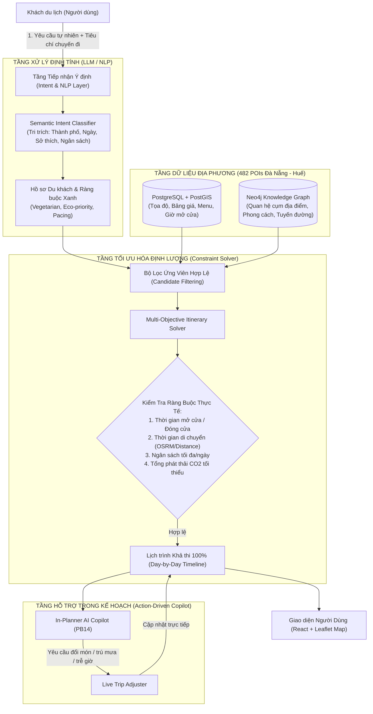

# BẢN PHÂN TÍCH THÍCH ỨNG: MÔ HÌNH MINDTRIP AI CHO ĐỒ ÁN TỐT NGHIỆP GREENTRIP AI

> **Dự án**: GreenTrip AI — Smart Travel Planner for Da Nang & Hue  
> **Mục tiêu**: Điều chỉnh toàn bộ khung phân tích nghiệp vụ, mô hình kinh doanh, kiến trúc kỹ thuật từ Mindtrip AI sang quy mô đồ án tốt nghiệp kỹ sư phần mềm (Capstone Project), đảm bảo vừa chuẩn chỉnh học thuật để đạt điểm tối đa trước Hội đồng, vừa có tính thực tiễn khả thi cao.

---

## 1. Xác Định Vấn Đề Nghiệp Vụ (Problem Framing)

### 1.1. Nỗi đau thị trường (Du khách đi Đà Nẵng - Huế)
Trong khi Mindtrip giải quyết bài toán phân mảnh du lịch toàn cầu, GreenTrip AI giải quyết bài toán phân mảnh đặc thù tại **vùng trọng điểm miền Trung (Đà Nẵng & Thừa Thiên Huế)** với góc nhìn **Du lịch Xanh & Trách nhiệm**:
- **Phân mảnh thông tin**: Du khách phải lướt TikTok/Reels để tìm quán ăn, mở Google Maps để đo khoảng cách, tra cứu Facebook để xem menu/giá cả, dùng Excel/Notion để xếp lịch.
- **Rủi ro "Bẫy du lịch" & Thiếu xác thực**: Nhiều quán ăn nổi tiếng bị quá tải, thông tin giờ mở cửa sai lệch, giá cả không minh bạch đối với khách ngoại tỉnh.
- **Xung đột di chuyển & Quá tải điểm đến (Overtourism)**: Khách du lịch thường dồn vào cùng một thời điểm ở Bán đảo Sơn Trà, Cầu Rồng hoặc Đại Nội Huế, gây kẹt xe và phát thải CO2 cao.
- **Hội chứng "Greenwashing" (Gắn mác xanh giả tạo)**: Nhiều điểm đến tự xưng là du lịch sinh thái nhưng không có tiêu chí định lượng minh bạch.

### 1.2. Định vị sản phẩm GreenTrip AI trong Đồ án
GreenTrip AI không sao chép máy móc toàn bộ nền tảng thương mại của Mindtrip (vốn đòi hỏi vốn hàng triệu USD và giấy phép OTA). Thay vào đó, GreenTrip AI định vị là:
> **Nền tảng Trợ lý Du lịch Thông minh & Điều phối Lịch trình Đa mục tiêu (Smart Travel Planner & Local Eco-Concierge)** chuyên sâu cho hành lang di sản Đà Nẵng – Huế, kết hợp AI tạo sinh (LLM) để thấu hiểu nhu cầu du khách với Thuật toán Tối ưu hóa Ràng buộc (Constraint Solver) để tạo lịch trình khả thi 100% về mặt thời gian, chi phí và phát thải carbon.

---

## 2. Thích Ứng Nghiệp Vụ Phía Khách Du Lịch (B2C: 7 Giai Đoạn)

Bảng đối soát giữa khả năng của Mindtrip AI và phạm vi triển khai tối ưu cho đồ án GreenTrip:

| Giai đoạn | Nghiệp vụ Mindtrip (Global Enterprise) | Phạm vi Thích ứng GreenTrip (Capstone Project) | Cơ chế Kỹ thuật Triển khai |
| :--- | :--- | :--- | :--- |
| **1. Inspiration (Cảm hứng)** | Guides toàn cầu, mạng xã hội, video, creator content. | Bộ sưu tập "Green Collections" & "Local Hidden Gems" cho Đà Nẵng & Huế (ẩm thực chay, cafe view sông Hàn, làng nghề cổ Phong Điền/Kim Bồng, di sản văn hóa). | 482 POIs đã chuẩn hóa với bộ lọc thẻ tag, điểm xanh (Green Score 0-100), ảnh minh chứng thực tế. |
| **2. Intent Capture (Tiếp nhận nhu cầu)** | Đa phương thức: Chat, PDF, Screenshot, import Google Maps Saved Places. | Form thông số chuyến đi (Thành phố, số ngày, số khách, phong cách) kết hợp **Natural Language Intent Parser** qua Semantic Rule-Engine / LLM. | Trích xuất thành JSON có cấu trúc (`TripContextPayload`: `destination`, `days`, `budget_tier`, `sustainability_focus`, `dietary`). |
| **3. Discovery (Khám phá)** | Gợi ý đa nguồn, tích hợp Tripadvisor/Google Reviews toàn cầu. | Khám phá 482 POIs địa phương sạch 100%, có menu bảng giá thực tế, ảnh món ăn, minh chứng Google Maps/Facebook. | Truy vấn PostGIS + Full-text search + Category Filter. Thẻ POI chuẩn UI/UX với 4 trạng thái, hiển thị rõ giá và Green Score. |
| **4. Trip Planning (Lập lịch trình)** | Tự động xếp lịch, AI sắp xếp ngày, kéo thả tự do. | **Lập lịch trình tối ưu đa mục tiêu (Multi-objective Solver)**: Cân bằng thời gian di chuyển, chi phí và chỉ số xanh (Carbon/Green Score). | Kết hợp Ma trận khoảng cách OSRM/Haversine + Graph RAG (Neo4j) + Thuật toán sắp xếp lịch trình (Greedy Heuristic / Genetic Algorithm). |
| **5. Collaboration (Cộng tác)** | Group chat thời gian thực, đồng chỉnh sửa (như Google Docs). | **Scope Lock (Giảm tải)**: Chia sẻ hành trình qua liên kết công khai (Public Shareable URL), Xuất file PDF / Tóm tắt hành trình, Tính năng Fork Trip. | Không làm Real-time WebSocket CRDT để tránh vỡ tiến độ. Dùng Token-based Public View (`/trips/share/{token}`). |
| **6. Booking & Management** | Đặt vé máy bay (Sabre), đặt phòng (Mindtrip Stays/PayPal). | **Scope Lock (Giảm tải)**: Nút "Chỉ đường Google Maps", "Liên hệ đặt bàn/chỗ trực tiếp" (Số điện thoại E.164, Fanpage) và Affiliate Deeplink. | Giả lập "Xác nhận cam kết xanh" (Green Travel Voucher/Pledge) thay vì tích hợp cổng thanh toán ngân hàng phức tạp. |
| **7. On-trip Assistance (Trợ lý trong chuyến đi)** | AI Agents theo dõi chuyến bay trễ, thông báo sự kiện thời gian thực. | **In-Planner AI Travel Copilot (PB14)**: Trợ lý hội thoại ngữ cảnh bám sát lịch trình: Đổi quán chay, Gợi ý trú mưa, Tối ưu khi trễ giờ, Tư vấn ẩm thực/cafe bản địa. | Dual Actions trên thẻ Copilot: `[Vị trí]` (highlight map + ảnh thật) & `[+ Thêm N.X]` (chèn trực tiếp vào lịch trình ngày đang chọn). |

---

## 3. Thích Ứng Nghiệp Vụ Doanh Nghiệp & Đối Tác (B2B)

Dù là đồ án sinh viên, việc đưa vào phân tích B2B sẽ giúp hội đồng đánh giá đề tài có **tầm nhìn chiến lược và khả năng thương mại hóa cao**:

### 3.1. Nghiệp vụ DMO (Destination Marketing Organizations — Sở Du lịch / Trung tâm Xúc tiến Du lịch Đà Nẵng & Huế)
- **Vấn đề của DMO**: Cần kích cầu du lịch bền vững, giãn khách khỏi các điểm nóng trung tâm (tránh quá tải Bán đảo Sơn Trà hay phố cổ), và đo lường hành vi du khách thực tế.
- **Giá trị GreenTrip mang lại**:
  - **Green Tourism Dashboard (Báo cáo Phân tích Hành vi Xanh)**: Thống kê tỷ lệ du khách lựa chọn xe điện (Danabus/Xanh SM), số lượng bữa ăn thuần chay được đề xuất, chỉ số CO2 ước tính tiết kiệm được.
  - **Điều phối dòng khách (Overtourism Mitigation)**: Khi các điểm du lịch cao điểm bị quá tải, thuật toán gợi ý của Copilot tự động phân luồng sang các điểm di sản vệ tinh ít đông đúc hơn (ví dụ: Chùa Nam Sơn, Huyền Không Sơn Thượng thay vì dồn hết vào Chùa Linh Ứng).

### 3.2. Nghiệp vụ Đối tác Địa phương (Green Businesses & Khách sạn/Quán ăn Xanh)
- **Không thu phí hoa hồng đặt chỗ (tránh xung đột pháp lý OTA)**: Thay vào đó, áp dụng mô hình **Green Merchant Directory**:
  - Các cơ sở kinh doanh F&B, lưu trú có thực hành xanh (không dùng đồ nhựa 1 lần, sử dụng nguyên liệu hữu cơ bản địa) được gắn nhãn chứng nhận "Green Verified" sau khi qua bộ kiểm duyệt.
  - Được ưu tiên xuất hiện trong top gợi ý của thuật toán xếp hạng bền vững (Sustainability Ranking).

---

## 4. Kiến Trúc Kỹ Thuật: Kết Hợp LLM Định Tính & Thuật Toán Tối Ưu Định Lượng

Đây là **luận điểm kỹ thuật cốt lõi** để bảo vệ trước Hội đồng chấm tốt nghiệp (dựa trên nghiên cứu của Google Research về Trip Planning):

### Tại sao không để LLM tự sinh 100% lịch trình?
- **Ảo giác (Hallucination)**: LLM có thể tự bịa ra giờ mở cửa, vị trí địa lý sai lệch (ví dụ: xếp đi Chùa Linh Ứng rồi ăn bánh bèo ở Huế trong vòng 30 phút).
- **Chi phí & Độ trễ**: Gọi LLM sinh toàn bộ tọa độ và ma trận thời gian rất chậm và tốn token.
- **Giải pháp của GreenTrip**:
  - **LLM / Rule-Engine**: Đóng vai trò "Người lắng nghe và thấu hiểu" (lọc ý định, giải thích lý do, tương tác tự nhiên).
  - **PostGIS + Solver**: Đóng vai trò "Bộ não toán học" (tính toán ma trận khoảng cách, sắp xếp thứ tự các điểm dừng sao cho cung đường di chuyển ngắn nhất và phát thải ít nhất).

---

## 5. Mô Hình Kinh Doanh Cho Đồ Án (Business Model Canvas)

| Thành phần Canvas | Nội dung Thích ứng cho GreenTrip AI |
| :--- | :--- |
| **Customer Segments (Khách hàng)** | 1. Du khách trẻ (Gen Z, Millennials) yêu thích du lịch trải nghiệm, văn hóa bản địa và có ý thức bảo vệ môi trường. 2. Nhóm bạn/Gia đình cần lịch trình hợp lý, không mệt mỏi. 3. Sở Du lịch Đà Nẵng / Huế (DMO) và các doanh nghiệp sinh thái địa phương. |
| **Value Propositions (Giá trị cung cấp)** | - Lịch trình khả thi 100%, không bịa đặt, có ảnh thật và menu giá thật. - Tối ưu hóa tuyến đường giảm phát thải CO2 và tiết kiệm chi phí. - Trợ lý Copilot hỗ trợ hành động trực tiếp (1-click thêm điểm vào lịch). |
| **Channels (Kênh tiếp cận)** | Web Application (Responsive Mobile-first), mã QR tại các trạm xe buýt/xe điện Xanh SM, fanpage du lịch địa phương. |
| **Customer Relationships** | Trợ lý cá nhân hóa theo thời gian thực (In-Planner Copilot), minh bạch tiêu chí chấm điểm xanh. |
| **Revenue Streams (Tiềm năng doanh thu)** | 1. Phí tài trợ hiển thị từ DMO cho các chiến dịch kích cầu du lịch xanh. 2. Phí xác thực nhãn "Green Partner" cho nhà hàng/khách sạn. 3. Hoa hồng tiếp thị liên kết (Affiliate referral) từ dịch vụ đặt xe điện, vé tham quan di sản. |
| **Key Resources (Tài nguyên chính)** | CSDL 482 POIs sạch đã qua 5 bước kiểm định CRM; Hệ tri thức Graph RAG; Thuật toán tối ưu hóa đa mục tiêu; Giao diện Design System đạt chuẩn WCAG 2.2 AA. |
| **Key Activities (Hoạt động cốt lõi)** | Thu thập và chuẩn hóa dữ liệu địa phương; Huấn luyện/tinh chỉnh bộ phân loại ý định; Phát triển thuật toán xếp lịch; Kiểm thử trải nghiệm người dùng. |
| **Key Partners (Đối tác chiến lược)** | Các hãng xe điện (Xanh SM, Danabus Đà Nẵng); Các hợp tác xã/làng nghề truyền thống; Ban quản lý bán đảo Sơn Trà & Quần thể Di tích Cố đô Huế. |
| **Cost Structure (Cơ cấu chi phí)** | Chi phí Server Cloud (PostgreSQL, Docker/FastAPI); Chi phí API LLM (Gemini API token tối ưu); Chi phí bảo trì dữ liệu. |

---

## 6. Phân Tích Đối Thủ & Lợi Thế Cạnh Tranh (Competitive Advantage)

| Tiêu chí | Google Maps | Tripadvisor | Mindtrip AI (Global) | **GreenTrip AI (Đồ án)** |
| :--- | :--- | :--- | :--- | :--- |
| **Phạm vi địa lý** | Toàn cầu | Toàn cầu | Toàn cầu (Tập trung US/Châu Âu) | **Chuyên sâu Đà Nẵng & Huế** |
| **Chỉ số Xanh & Bền vững** | Cơ bản (tuyến đường tiết kiệm xăng) | Gần như không có | Chứng nhận sinh thái cơ bản | **Green Score định lượng (0-100) + Đo lường Carbon** |
| **Độ tin cậy dữ liệu địa phương** | Nhiều spam, đánh giá ảo | Nhiều bài review thương mại | Dữ liệu cào web chưa kiểm duyệt kỹ | **482 POIs làm sạch thủ công, có menu thật & ảnh thật** |
| **Cơ chế lập lịch trình** | Lưu danh sách ghim rời rạc | Đọc bài viết mẫu | AI sinh tự do (dễ ảo giác lộ trình) | **Thuật toán tối ưu hóa ràng buộc định lượng** |
| **Tương tác hành động (Action-driven)** | Chỉ mở đường đi | Chuyển link sang OTA | Chat + Card thông tin | **Copilot chèn/thay thế trực tiếp vào dòng thời gian** |

---

## 7. Khuyến Nghị Trình Bày Trước Hội Đồng Tốt Nghiệp

1. **Khẳng định tính thực tế**: Không giới thiệu một "AI Chatbot biết tuốt" mà giới thiệu một **Hệ Thống Lập Lịch Trình Chuyên Sâu Có AI Hỗ Trợ**.
2. **Nhấn mạnh bài toán Du lịch Xanh**: Nêu rõ công thức tính điểm xanh và thuật toán tối ưu phát thải — đây là đề tài có ý nghĩa xã hội và rất được hội đồng học thuật đánh giá cao.
3. **Demo sống động bằng luồng hành động (Action-driven)**: Thể hiện rõ việc hỏi Copilot -> Nhận gợi ý có ảnh thật & giá thật -> Nhấn `[+ Thêm N.1]` -> Lịch trình tự động tính toán lại thời gian và cung đường.
