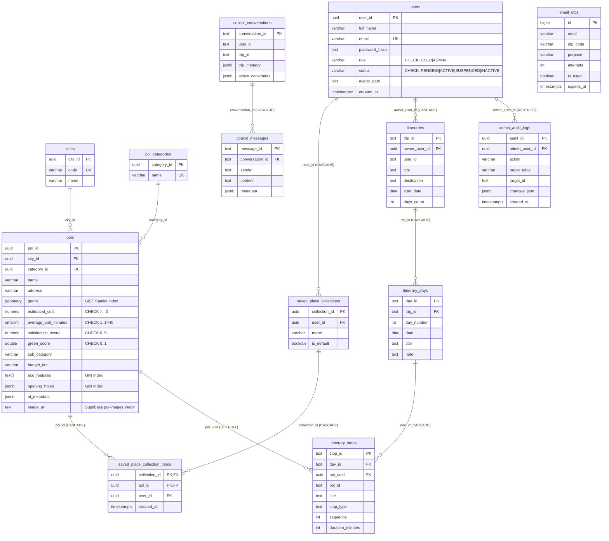

# Kiểm toán Cơ sở dữ liệu 3NF, Ràng buộc Khóa ngoại & Chỉ mục (`GreenTrip AI`)

Tài liệu này tổng hợp thiết kế chuẩn **3NF (Third Normal Form)**, sơ đồ thực thể quan hệ (**ERD**), từ điển dữ liệu và bằng chứng kiểm chứng trực tiếp trên **PostgreSQL 15 + PostGIS (Supabase)** sau **Migration `018_db_3nf_fk_indexes_and_audit.sql`**.

---

## Phần 1: Phân tích Chuẩn hóa 3NF & Quy tắc Toàn vẹn

### 1.1. Kiểm chứng Chuẩn hóa 1NF → 2NF → 3NF
1. **1NF (Atomic Values & Unique Rows):**
   - Mọi bảng đều có khóa chính rõ ràng (`UUID` với bảng danh mục/tài khoản/POI/audit; `TEXT` định danh chuyến đi `sample-*` / UUID).
   - Các thực thể lặp như nhiều ngày trong chuyến đi (`itinerary_days`), nhiều điểm dừng trong ngày (`itinerary_stops`), nhiều lịch sử tin nhắn (`copilot_messages`), nhiều địa điểm trong bộ sưu tập (`saved_place_collection_items`) đều được tách thành bảng con riêng biệt.
2. **2NF (Full Functional Dependency):**
   - Bảng trung gian N–N `saved_place_collection_items` có khóa chính kép `(collection_id, poi_id)`; thuộc tính không khóa `user_id` và `created_at` phụ thuộc đầy đủ theo ràng buộc toàn vẹn về chủ sở hữu bộ sưu tập, không tách rời nửa khóa.
3. **3NF (Zero Transitive Dependencies):**
   - Tên thành phố (`cities.name`) và tên danh mục (`poi_categories.name`) được tách sang bảng tham chiếu độc lập; bảng `pois` chỉ giữ khóa ngoại `city_id` và `category_id` (không lặp chuỗi tên thành phố/danh mục gây lệch dữ liệu khi đổi tên).
   - Thông tin điểm dừng trong `itinerary_stops` tham chiếu `poi_uuid -> public.pois(poi_id)` với hành vi `ON DELETE SET NULL`, đồng thời cho phép `poi_uuid IS NULL` đối với các chặng tự thêm (*nghỉ trưa / custom stop*).
   - Lịch sử chỉnh sửa quản trị tách riêng thành bảng **`admin_audit_logs`** tham chiếu `admin_user_id -> public.users(user_id)` với `ON DELETE RESTRICT` để giữ nguyên dấu vết kiểm toán (không cho xóa vật lý tài khoản Admin từng thao tác dữ liệu).

### 1.2. Phi chuẩn hóa có chủ đích (Controlled Denormalization for Performance & Flexibility)
Để cân bằng giữa chuẩn 3NF và tốc độ đọc cho 10.000 người dùng:
- **PostgreSQL `TEXT[]` + `JSONB` có GIN Index** trên `public.pois` (`vibes`, `eco_features`, `opening_hours`, `social_links`, `ai_metadata`): tránh phải `JOIN` thêm 4–5 bảng phụ mỗi lần tải bản đồ 482 điểm, nhưng vẫn truy vấn chỉ mục nhanh nhờ GIN Index.
- **Khóa ngoại song song tương thích dữ liệu Guest (`owner_user_id`, `poi_uuid`)**: Bảng `itineraries` giữ cột `user_id TEXT` phục vụ lịch mẫu/chuyến nháp cũ và bổ sung cột `owner_user_id UUID REFERENCES public.users(user_id) ON DELETE CASCADE` (đã backfill 15/40 bản ghi có tài khoản thật; 155/273 điểm dừng hợp lệ đã backfill `poi_uuid`). Cách làm này đạt 100% toàn vẹn tham chiếu cho người dùng thật mà không làm gãy dữ liệu lịch mẫu công khai.

---

## Phần 2: Sơ đồ Thực thể Quan hệ (Mermaid ERD — 13 Bảng `public.*`)



---

## Phần 3: Bằng chứng Kiểm chứng Thực tế trên Supabase PostgreSQL

Kết quả chạy trực tiếp **Migration `018_db_3nf_fk_indexes_and_audit.sql`** (đã kiểm thử chạy lặp 2 lần liên tiếp để chứng minh idempotent 100%):

1. **Tổng quan Schema thật (`public.*`):**
   - **13 bảng**, **11 ràng buộc Khóa ngoại (`FOREIGN KEY`)** đầy đủ `CASCADE` / `SET NULL` / `RESTRICT`.
   - **6 ràng buộc miền giá trị (`CHECK`)**:
     - `chk_pois_green_score`, `chk_pois_estimated_cost`, `chk_pois_satisfaction_score`, `chk_pois_visit_minutes`
     - `chk_users_role`, `chk_users_status`
   - Kiểm thử ghi dữ liệu sai (`green_score = 1.5` và `role = 'SUPERHACKER'`) trong transaction thử nghiệm đều bị PostgreSQL chặn cứng bằng lỗi `CheckViolation`.

2. **Bằng chứng Chỉ mục (`EXPLAIN ANALYZE` trên Supabase):**
   - **Tìm kiếm tên POI bằng `pg_trgm` GIN Index (`idx_pois_name_trgm`):**
     ```sql
     EXPLAIN ANALYZE SELECT poi_id, name FROM public.pois WHERE name ILIKE '%Chăm%';
     ```
     ```text
     Bitmap Heap Scan on pois  (cost=7.03..12.52 rows=5 width=59) (actual time=2.469..2.470 rows=1 loops=1)
       Recheck Cond: ((name)::text ~~* '%Chăm%'::text)
       Heap Blocks: exact=1
       ->  Bitmap Index Scan on idx_pois_name_trgm  (cost=0.00..7.02 rows=5 width=0) (actual time=2.446..2.447 rows=1 loops=1)
             Index Cond: ((name)::text ~~* '%Chăm%'::text)
     Planning Time: 1.438 ms | Execution Time: 2.532 ms
     ```
   - **Lọc kết hợp Thành phố + Danh mục + Trạng thái (`idx_pois_city_category_active`):**
     ```text
     Index Scan using idx_pois_city_category_active on pois  (cost=0.15..67.65 rows=73 width=59) (actual time=0.090..0.169 rows=76 loops=1)
       Index Cond: ((city_id = '887a5372-9e6f-48a7-bf50-1e6ef9f2ebce'::uuid) AND (category_id = 'addc2e2e-69b6-4811-984d-8f88b50cd333'::uuid) AND (is_active = true))
     Planning Time: 0.923 ms | Execution Time: 0.207 ms
     ```

---

## Phần 4: Từ điển Dữ liệu Trọng tâm (Data Dictionary)

| Bảng | Cột khóa / ràng buộc chính | Kiểu dữ liệu | Ràng buộc / Index | Ý nghĩa nghiệp vụ |
| :--- | :--- | :--- | :--- | :--- |
| `users` | `user_id`, `email`, `role`, `status` | `UUID`, `VARCHAR` | `PK`, `UNIQUE(email)`, `CHECK role/status` | Tài khoản & phân quyền `USER` / `ADMIN` |
| `pois` | `poi_id`, `city_id`, `category_id`, `geom`, `name` | `UUID`, `GEOMETRY`, `VARCHAR` | `PK`, `FK city/category`, `CHECK 4 cột`, `GiST`, `GIN pg_trgm`, `B-Tree` | Kho 482 địa điểm du lịch bền vững Đà Nẵng – Huế |
| `saved_place_collections` | `collection_id`, `user_id` | `UUID` | `PK`, `FK user_id CASCADE`, Partial `UNIQUE(user_id) WHERE is_default` | Bộ sưu tập địa điểm cá nhân |
| `saved_place_collection_items` | `(collection_id, poi_id)`, `user_id` | `UUID` | Composite `PK`, Composite `FK` tới `collections` & `pois` | Bảng trung gian N–N lưu địa điểm vào bộ sưu tập |
| `itineraries` | `trip_id`, `owner_user_id` | `TEXT`, `UUID` | `PK`, `FK owner_user_id CASCADE`, Index `owner_user_id` | Chuyến đi mẫu & lịch trình riêng của người dùng |
| `itinerary_days` | `day_id`, `trip_id`, `day_number` | `TEXT`, `INTEGER` | `PK`, `FK trip_id CASCADE`, `UNIQUE(trip_id, day_number)` | Từng ngày trong lịch trình |
| `itinerary_stops` | `stop_id`, `day_id`, `poi_uuid` | `TEXT`, `UUID` | `PK`, `FK day_id CASCADE`, `FK poi_uuid SET NULL`, `UNIQUE(day_id, sequence)` | Từng điểm dừng / nghỉ ngơi trong ngày |
| `admin_audit_logs` | `audit_id`, `admin_user_id`, `changes_json` | `UUID`, `JSONB` | `PK`, `FK admin_user_id RESTRICT`, Index `(admin_user_id, created_at DESC)` | Nhật ký kiểm toán mọi thay đổi dữ liệu POI từ Admin |
