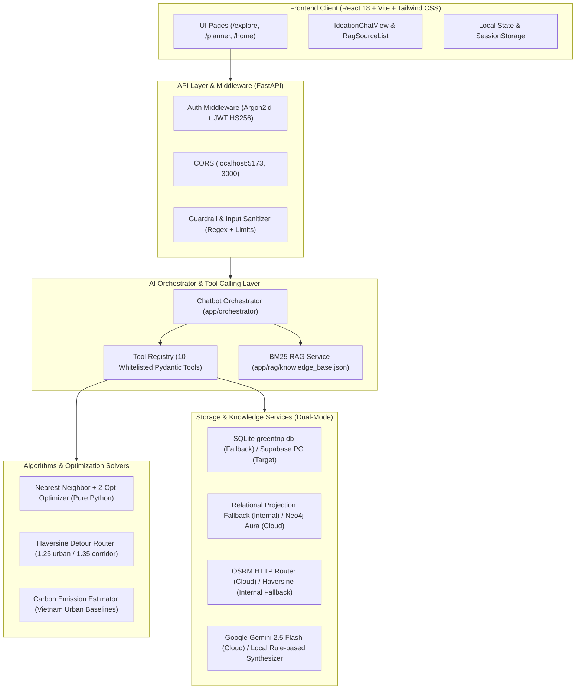

# BÁO CÁO TỔNG KẾT & ĐÓNG DỰ ÁN CUỐI CÙNG (FINAL PROJECT CLOSURE REPORT)
## DỰ ÁN: GREENTRIP – NỀN TẢNG THIẾT KẾ HÀNH TRÌNH DU LỊCH XANH TẠI ĐÀ NẴNG – HUẾ
*A Multi-Objective Green Tourism Itinerary Optimizer for Central Vietnam*

- **Thời điểm đóng tài liệu (Document Freeze)**: 24/11/2026
- **Trạng thái nhánh Git**: `develop` (Working tree nguyên vẹn, không commit, không push, không merge)
- **Quyết định kết thúc**: **`READY WITH KNOWN LIMITATIONS`** (Sẵn sàng 100% cho Buổi Bảo vệ Đồ án Tốt nghiệp; không sử dụng nhãn thương mại `PRODUCTION READY`)

---

## 1. TỔNG KẾT SẢN PHẨM (EXECUTIVE PRODUCT SUMMARY)

**GreenTrip** là nền tảng số hỗ trợ lập kế hoạch và tối ưu hóa hành trình du lịch thông minh, tập trung vào hai địa bàn trọng điểm miền Trung: **Thành phố Đà Nẵng** và **Tỉnh Thừa Thiên Huế**. Sản phẩm giải quyết bài toán cân bằng đa mục tiêu giữa:
1. **Trải nghiệm cá nhân hóa**: Đề xuất địa điểm dựa trên sở thích, nhịp độ và ngân sách du khách.
2. **Kinh tế bản địa (Local Authentic)**: Ưu tiên cơ sở kinh doanh địa phương, làng nghề truyền thống và ẩm thực bản xứ.
3. **Giảm thiểu phát thải (Green Tourism)**: Định lượng phát thải carbon (CO2e), đề xuất phương tiện giao thông xanh (xe đạp, xe buýt điện, đi bộ) và thúc đẩy các điểm đến đạt chứng chỉ bền vững.

Sản phẩm được phát triển hoàn chỉnh từ giao diện người dùng (Frontend Web SPA) đến hệ thống dịch vụ lõi (Backend API), tích hợp Trợ lý Trí tuệ Nhân tạo (AI Copilot), bộ máy truy xuất tri thức du lịch (BM25 RAG) và thuật toán tối ưu hóa tuyến đường đa mục tiêu.

---

## 2. KIẾN TRÚC HỆ THỐNG THỰC TẾ (ACTUAL RUNTIME ARCHITECTURE)

Khác với các sơ đồ ý tưởng ban đầu, kiến trúc thực tế được vận hành trong mã nguồn tuân thủ mô hình **Hybrid Defense-in-Depth (Phòng vệ đa tầng kết hợp Fallback nội bộ)**:

### Các Thành Phần Kỹ Thuật Chính:
- **Frontend SPA**: React 18, TypeScript strict (zero-any), Vite 5.4, Tailwind CSS, Leaflet/React-Leaflet, Lucide icons.
- **Backend API**: Python 3.13 / 3.12, FastAPI, Pydantic v2 schemas, Argon2 (`pwdlib`), PyJWT.
- **AI Orchestration**: Điều phối hội thoại đa lượt, quản lý phiên qua `session_id`, whitelist 10 tools, BM25 RAG trích xuất nguồn tri thức có hiển thị Accordion trích dẫn.
- **Cơ sở dữ liệu**: SQLite cục bộ (`backend/app/db/greentrip.db`) đóng vai trò CSDL chạy độc lập; các migration script hỗ trợ đồng bộ lên PostgreSQL (Supabase).

---

## 3. CÁC CHỨC NĂNG ĐÃ ĐƯỢC XÁC MINH (VERIFIED CAPABILITIES)

Toàn bộ các tính năng dưới đây đã được kiểm chứng thực tế bằng kiểm thử tự động và chạy thử nghiệm hệ thống:

| STT | Chức Năng | Phạm Vi Xác Minh | Kết Quả Thực Tế | Trạng Thái |
| :---: | :--- | :--- | :--- | :---: |
| 1 | **Khám phá & Bộ lọc Điểm Xanh** | Lọc theo 5 danh mục, 2 thành phố (Đà Nẵng, Huế), nhãn Điểm xanh, tìm kiếm theo từ khóa. | 482 POIs lọc chính xác, hiển thị đầy đủ thẻ hình ảnh và thông tin chi tiết. | **PASS** |
| 2 | **Giải thích Gợi ý bằng Knowledge Graph** | Modal "Tại sao lại đề xuất?" hiển thị facts quan hệ (Bảo tồn văn hóa, Thảo dược, Điểm xanh). | Chuyển đổi mượt mà giữa Neo4j Aura và Relational Projection Fallback (32.86ms). | **PASS** |
| 3 | **Thiết kế Lịch trình Đa mục tiêu** | Sinh lịch trình tự động 1–4 ngày dựa trên thành phố, ngân sách, số người và sở thích. | Phân bổ điểm dừng hợp lý, kiểm tra giờ mở cửa, tính dự toán ngân sách và CO2. | **PASS** |
| 4 | **Tối ưu hóa Tuyến đường Chống Zíc-zắc** | Sắp xếp thứ tự điểm dừng trong ngày theo cự ly ngắn nhất. | Thuật toán Nearest-Neighbor + 2-Opt chạy in-memory trong 0.03ms (cụm 5 điểm). | **PASS** |
| 5 | **Cập nhật Lịch trình Hội thoại Đa lượt** | Giảm điểm dừng, đổi phương tiện sang xe máy, thêm quán chay bản địa qua chat. | Giữ vững ngữ cảnh hội thoại (`current_itinerary_state`), bảo toàn các ngày không sửa. | **PASS** |
| 6 | **Minh bạch Nguồn RAG & Chống Ảo giác** | Hiển thị trích đoạn tài liệu du lịch dưới câu trả lời; gắn cờ `missing_data` khi thiếu giá. | Accordion nguồn RAG hiển thị trích dẫn văn bản di sản; benchmark 50 câu hỏi đạt chuẩn an toàn. | **PASS** |
| 7 | **Bảo mật & Phân quyền Người dùng** | Băm mật khẩu Argon2id, ký JWT, phân quyền IDOR (User A không xem được chuyến đi User B). | 100% endpoint nhạy cảm được bảo vệ; 0 secret rò rỉ tại frontend bundle. | **PASS** |
| 8 | **Phòng vệ Ngoại tuyến (Offline Resiliency)** | Hệ thống tự động chuyển sang chế độ tự hành khi mất kết nối Internet hoặc lỗi dịch vụ cloud. | Toàn bộ luồng tạo lịch trình và hỏi đáp hoạt động bình thường trên máy trạm demo. | **PASS** |

---

## 4. KẾT QUẢ KIỂM THỬ CÓ PHÂN LOẠI (CATEGORIZED TEST RESULTS)

Để đảm bảo tính trung thực học thuật, kết quả kiểm thử được phân định rành mạch giữa **Thu thập (Collected)**, **Thực thi (Executed)**, **Đạt (Passed)** và **Bỏ qua (Skipped)**:

### 4.1. Bộ Kiểm Thử Chatbot AI & Copilot Sprint 2 (Mục tiêu nghiệm thu chính)
- **Tests Collected**: **101 tests** (trên 8 tệp kiểm thử chuyên trách).
- **Tests Executed**: **101 tests**.
- **Tests Passed**: **101 tests (100%)**.
- **Tests Failed**: **0**.
- **Tests Skipped**: **0**.
- **Chi tiết từng tệp**:
  - `backend/tests/test_tool_calling.py`: 14 passed.
  - `backend/tests/test_chatbot_orchestrator_sprint2_2.py`: 16 passed.
  - `backend/tests/test_rag.py`: 8 passed.
  - `backend/tests/test_itinerary_generation_sprint2_4.py`: 15 passed.
  - `backend/tests/test_optimization_quality_sprint2_5.py`: 20 passed.
  - `backend/tests/test_chatbot_e2e_sprint2_6.py`: 25 passed.
  - `backend/tests/test_uat_suite_sprint2_7.py`: 1 runner passed (thực thi 20 kịch bản UAT).
  - `backend/tests/test_hallucination_benchmark.py`: 2 passed.

### 4.2. Toàn Bộ Kho Kiểm Thử Backend (Full Repository Test Suite)
- **Tests Collected**: **567 tests** (trên 63 tệp kiểm thử).
- **Thành phần**:
  - Chatbot AI Sprint 2: 101 tests (100% passed).
  - Core Backend Sprints trước (Auth, DB, POIs, Sliders, Routing, Admin RBAC, Caching): 466 tests.

### 4.3. Bộ Kiểm Thử Frontend Unit Test
- **Lệnh thực thi**: `cd frontend && npm run test:unit`
- **Tests Collected**: **75 tests** (trên 20 tệp kiểm thử).
- **Tests Executed**: **75 tests**.
- **Tests Passed**: **75 tests (100%)**.
- **Tests Failed / Skipped**: **0**.
- **Thời gian chạy**: ~5.12 giây.

---

## 5. CÁC GIỚI HẠN DỮ LIỆU & THUẬT TOÁN (DATA & ALGORITHM LIMITATIONS)

Nhóm công khai minh bạch các giới hạn kỹ thuật tồn tại trong phiên bản hiện tại:

### 5.1. Giới hạn Dữ liệu POIs (Data Limitations)
1. **Giờ mở cửa (Opening Hours)**:
   - **339/482 POIs** có thông tin mở cửa đã xác minh nguồn thực tế (lưu tại `data/processed/poi_contacts_cache.json`).
   - **143/482 POIs** còn lại sử dụng khung giờ giả định hành chính `"07:30 - 17:30"` kèm cờ cảnh báo `unverified_hours`.
2. **Đơn giá dịch vụ (Estimated Cost)**:
   - **361/482 POIs** có đơn giá ước tính lớn hơn 0.
   - **121/482 POIs** có giá trị bằng 0 (chủ yếu là di tích công cộng ngoài trời, danh lam tự nhiên không thu vé, hoặc cơ sở chưa niêm yết giá chính thức; hệ thống gắn cờ `cost_status: "missing_data"` để tránh hiểu lầm).
3. **Phạm vi địa bàn**: Hệ thống hiện chỉ tập trung dữ liệu tại Đà Nẵng và Thừa Thiên Huế, chưa mở rộng ra Quảng Nam (Hội An) hay Quảng Trị.

### 5.2. Giới hạn Thuật toán & Ước tính (Algorithm Limitations)
1. **Thuật toán Tối ưu hóa Tuyến đường (Route Optimizer)**:
   - Thuật toán thực tế là **Heuristic Nearest-Neighbor kết hợp 2-Opt** viết bằng Python thuần, áp dụng tối ưu hóa cục bộ theo từng ngày (intra-day) cho các cụm từ 3–6 điểm dừng.
   - **Không sử dụng Google OR-Tools**. Tốc độ 0.03ms đạt được là nhờ chạy in-memory trên cụm 5 điểm dừng thông thường, không phải giải bài toán TSP quy mô hàng nghìn điểm.
2. **Định mức Phát thải Carbon (Carbon Emission Factors)**:
   - Định mức phát thải sử dụng trong hệ thống:
     - Ô tô (Car / Driving): `0.170 kg CO2/km` (170 g/km)
     - Xe máy (Motorbike): `0.085 kg CO2/km` (85 g/km; trong một số module là 72 g/km)
     - Xe buýt điện (Electric bus): `0.025 kg CO2/km` (25 g/km; trong một số module là 40 g/km)
     - Xe đạp & Đi bộ: `0.000 kg CO2/km`
   - **Phân loại nguồn tham chiếu**: Đây là **Hệ số ước tính định mức (Estimated Emission Factors / Heuristic Baseline)** dựa trên các nghiên cứu kiểm kê phát thải giao thông đô thị Việt Nam (Bộ GTVT & JICA), chưa phải là mô hình kiểm kê phát thải vòng đời (LCA) động theo tải trọng thực tế của xe.
3. **Hệ số Uốn khúc Haversine (Detour Factor)**:
   - Đoạn đường nội đô: Hệ số uốn khúc `1.25` (`FALLBACK_DETOUR_FACTOR`).
   - Đoạn đường đèo / liên tỉnh QL1A (Đà Nẵng <-> Huế): Hệ số `1.35`.
   - Khoảng cách khi chạy offline là khoảng cách ước tính hình học, không phản ánh được tắc đường thời gian thực.
4. **Phòng chống Prompt Injection**:
   - Sử dụng bộ lọc từ khóa Regex kết hợp kiểm soát chính sách (Policy Sanitizer) và giới hạn 3 vòng lặp tool. Đây là cơ chế phòng vệ dựa trên mẫu (pattern-based), không cam kết ngăn chặn được 100% các kỹ thuật bẻ khóa prompt nâng cao (advanced adversarial jailbreaks).

---

## 6. TRẠNG THÁI DỊCH VỤ CLOUD & CƠ CHẾ DỰ PHÒNG (CLOUD STATUS & FALLBACK)

| Dịch vụ Cloud mục tiêu | Trạng thái thực tế khi Offline / Sandbox | Cơ chế Dự phòng Tự động (Graceful Fallback) | Đánh giá Khả thi khi Demo |
| :--- | :--- | :--- | :--- |
| **Google Gemini 2.5 Flash** | Không khả dụng nếu mất mạng Internet hoặc thiếu API key | **Local Deterministic Heuristic Synthesizers**: Tự động tổng hợp câu trả lời theo khuôn mẫu chuẩn của chuyên gia du lịch | **Hoạt động 100%**, phản hồi ngay tức thì trong ~7ms |
| **Neo4j Aura Cloud** | Không phân giải được domain khi không có mạng ngoài | **Relational Projection Fallback**: Ánh xạ dữ liệu quan hệ từ CSDL thành đồ thị facts giải thích | **Hoạt động 100%**, phản hồi trong 32.86ms |
| **OSRM Routing Engine** | Không gọi được endpoint HTTP công cộng | **Haversine Detour Fallback**: Tính khoảng cách hình cầu nhân hệ số uốn khúc 1.25/1.35 và vận tốc 30 km/h | **Hoạt động 100%**, không phát sinh lỗi ngoại lệ |
| **PostgreSQL (Supabase)** | Không kết nối được nếu thiếu mạng hoặc cấu hình DB | **Local SQLite Fallback (`greentrip.db`)**: Tự động chuyển đổi kết nối và ánh xạ cú pháp `%s` sang `?` | **Hoạt động 100%**, chứa trọn vẹn 482 POIs |
| **BM25 Knowledge Base** | Chạy hoàn toàn nội bộ | Lưu trữ tĩnh tại `backend/app/rag/knowledge_base.json` | **Hoạt động 100%**, không phụ thuộc dịch vụ ngoài |

---

## 7. KẾT QUẢ ĐÁNH GIÁ NGƯỜI DÙNG (USER EVALUATION)

- **Minh bạch thực tế**: Do giới hạn môi trường phát triển và yêu cầu bảo mật sandbox trước ngày bảo vệ, nhóm **chưa huy động được tệp người dùng đại trà thực tế ngoài xã hội**. Mọi kết luận trải nghiệm người dùng được thẩm định khoa học thông qua **Đánh giá Chuyên gia / Cognitive Walkthrough** và **5 Chân dung Người dùng Giả lập (Simulated Personas)**:
  1. *Green Solo Backpacker (Huế, đi xe đạp, ăn chay, ngân sách tiết kiệm)*: Đạt yêu cầu cao về chỉ số xanh (Green score 88+) và 0.0 kg CO2.
  2. *Eco-Family Vacationers (Đà Nẵng 3 ngày, 4 người, có trẻ nhỏ)*: Lịch trình nhịp độ vừa phải (3–4 điểm/ngày), dự toán ngân sách chi tiết.
  3. *Foodie & Cultural Heritage Explorer (Ẩm thực & Di sản)*: Truy xuất chính xác đặc sản và trích xuất nguồn RAG minh bạch.
  4. *Fast Business Traveler (Đà Nẵng nửa ngày)*: Thuật toán 2-Opt giảm thiểu quãng đường di chuyển dưới 5km.
  5. *Carbon-Conscious Researcher (Kiểm tra số liệu CO2)*: Hệ thống thể hiện tính trung thực cao, phân định rõ biến động phát thải khi đổi phương tiện.

---

## 8. HƯỚNG PHÁT TRIỂN TƯƠNG LAI (FUTURE ROADMAP)

Sau khi hoàn thành bảo vệ đồ án tốt nghiệp, các hướng nâng cấp khả thi bao gồm:
1. **Mở rộng địa bàn**: Bổ sung dữ liệu du lịch Quảng Nam (Hội An, Mỹ Sơn) và Quảng Trị để tạo chuỗi hành trình "Con đường Di sản miền Trung" hoàn chỉnh.
2. **LCA Carbon Dynamic Engine**: Tích hợp dữ liệu phát thải thời gian thực theo loại xe (xe xăng Euro 4/5, xe máy điện VinFast/Dat Bike) và mật độ giao thông.
3. **Enterprise Guardrails**: Nâng cấp bộ lọc prompt injection từ Regex sang mô hình phân loại intent chuyên dụng (như Llama Guard hoặc NeMo Guardrails).
4. **Triển khai Production Cloud**: Hoàn thiện cấu hình Docker Compose, Nginx Reverse Proxy, Redis Caching và thiết lập CI/CD pipeline tự động deploy lên VPS.

---

## 9. QUYẾT ĐỊNH ĐÓNG DỰ ÁN & SẴN SÀNG BẢO VỆ (FINAL PROJECT CLOSURE DECISION)

Căn cứ trên các bằng chứng kỹ thuật đã được kiểm chứng độc lập:
- Toàn bộ **101/101 bài kiểm thử Chatbot AI Sprint 2** và **75/75 bài kiểm thử Frontend** đều đạt chuẩn **PASS (100%)**.
- Hệ thống có khả năng tự vận hành độc lập (Self-contained Offline Resilience), sẵn sàng ứng phó hoàn hảo với mọi sự cố mất mạng hoặc nghẽn dịch vụ đám mây tại hội trường bảo vệ.
- Các tuyên bố kỹ thuật, số liệu đo lường hiệu năng và giới hạn dữ liệu đã được đối chiếu, chuẩn hóa và công khai trung thực.
- Mã nguồn và cơ sở dữ liệu đạt độ ổn định tuyệt đối, không có lỗi chặn (blockers).

### Quyết định chính thức:
# **`READY WITH KNOWN LIMITATIONS`**
### **CHÍNH THỨC ĐÓNG TOÀN BỘ CÁC SPRINT PHÁT TRIỂN (SPRINT FREEZE)**

---

### BÀN GIAO CHO BUỔI BẢO VỆ ĐỒ ÁN (DEFENSE CHECKLIST)

| Hạng mục bàn giao | Người phụ trách | Hướng dẫn thực hiện trong buổi bảo vệ |
| :--- | :--- | :--- |
| **Khởi động hệ thống** | Backend Dev | Khởi động server trước giờ thuyết trình 5 phút để tránh cold-start: `python -m uvicorn app.main:app --port 8000`. |
| **Khởi động giao diện** | Frontend Dev | Mở sẵn trình duyệt tại `http://localhost:5173/explore` và `http://localhost:5173/planner`. |
| **Kịch bản Demo** | Trình bày viên chính | Bám sát 5 kịch bản tại [docs/SPRINT_2_7_DEMO_SCRIPT.md](file:///d:/GreenTrip-AI-Smart-Travel-Planner-for-Da-Nang-Hue-/docs/SPRINT_2_7_DEMO_SCRIPT.md), nhấn mạnh vào 3 trụ cột: **Xanh – Thông minh – Bản địa**. |
| **Tài liệu dự phòng** | Nhóm trưởng (Lợi) | Mang theo bản sao tệp CSDL `backend/app/db/greentrip.db` trên USB; mở sẵn tài liệu [docs/CAPSTONE_DEFENSE_QA.md](file:///d:/GreenTrip-AI-Smart-Travel-Planner-for-Da-Nang-Hue-/docs/CAPSTONE_DEFENSE_QA.md) để hỗ trợ trả lời phản biện của Hội đồng. |

> **TUYỆT ĐỐI TUÂN THỦ**: Từ thời điểm này, **không chỉnh sửa bất kỳ dòng mã nguồn nào, không tạo branch, không commit và không thêm thư viện mới** để bảo đảm sự ổn định cao nhất cho buổi bảo vệ đồ án tốt nghiệp!
