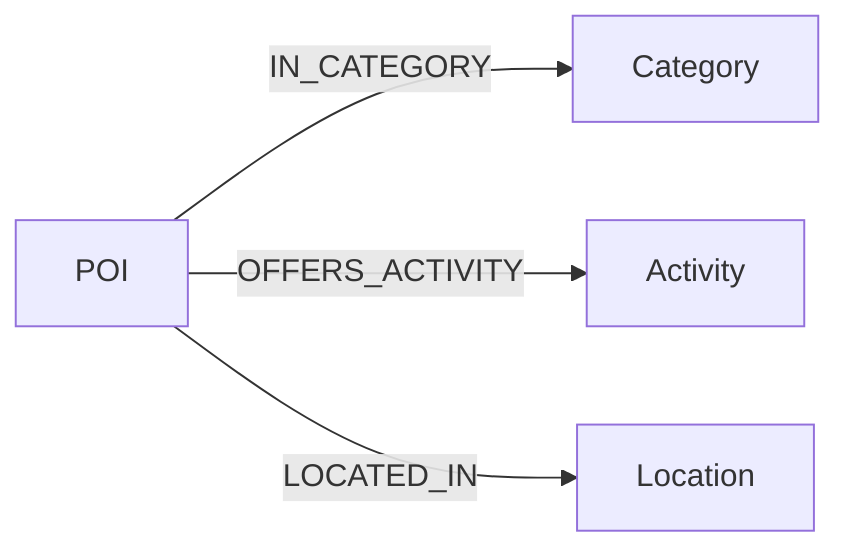

# GreenTrip AI Knowledge Graph

## Purpose

Neo4j stores a small semantic projection of GreenTrip POI facts for
recommendation evidence and fact-based "Why this place?" explanations.
Supabase PostgreSQL/PostGIS remains the source of truth for POIs, coordinates,
users, itineraries, scores, and transactional data.

PB10 consumes graph facts for explanations. PB09 remains the recommendation
scoring source, while PostgreSQL remains authoritative for POI and trip data.
The Phase 2 Graph Builder prepares a read-only PostgreSQL projection for a
separately approved Neo4j apply step; it does not change recommendation scores.

## Repository and Data Findings

- A read-only `information_schema` check confirms that `public.pois.poi_id` is
  the non-null UUID primary key. The active POI repository reads this key, joins
  `public.poi_categories` and `public.cities`, and reads coordinates from a
  PostGIS `geom` column.
- `backend/migrations/001_create_pois.sql` documents an older flat schema with
  an identity `id`; it does not match the current repository/import contract.
  New graph integrations must use the current `poi_id`, not the legacy ID.
- The API POI model exposes ID, name, category, description, coordinates,
  address, and city.
- A read-only source check found 642 POIs: 580 active and 62 inactive. The
  active rows use six category names and two city codes: `DANANG` and `HUE`.
- The dataset includes `is_local_business` and `local_business_type`. Businesses
  are already represented as POIs, so a separate business node would duplicate
  the same entity.
- There is no normalized Activity table. Phase 2 maps only exact whitelisted
  `sub_category`, `vibes`, `ai_metadata.dna_tags`, `activity_tags`,
  `experience_tags`, and `activities` values. Unknown values are reported and
  omitted; POI names, descriptions, and free text are never used to infer an
  Activity.
- The raw OSM source records provider and ODbL license metadata. The curated
  enrichment also records its source. Current PostgreSQL import does not retain
  OSM IDs or cuisine, so those values cannot replace `poi_id` as graph identity.
- Existing Neo4j support includes the Aura driver, graph schema, sample graph,
  PB10 explanation query, and local-authentic POI query. The Phase 2 importer is
  not run automatically by application startup.

## Node Types

| Label | Purpose | Key property | Important properties |
| --- | --- | --- | --- |
| `POI` | Semantic projection of a PostgreSQL tourist place or business | `id` | `name`, `is_active`, `source_updated_at`, `is_local_business`, optional `local_business_type`, optional `source` |
| `Category` | Controlled POI classification already represented relationally | `key` | `name` |
| `Activity` | Controlled traveler activity offered by a POI | `key` | `name` |
| `Location` | City-level semantic context, not a GIS replacement | `key` | `name`, `level` |
| `GraphSyncState` | Importer lease and completed source cursor; operational only | `key` | lease and checkpoint values |

### POI property boundary

The graph keeps only identity and explanation-relevant properties. Full
descriptions, coordinates, addresses, opening hours, scores, costs, and route
data remain in PostgreSQL/PostGIS. `source` is an optional compact provenance
value such as `OpenStreetMap` or `curated`; no separate provenance ontology is
needed for the MVP.

### Controlled semantic keys

Current category values map to stable graph keys:

| Current value | Graph key |
| --- | --- |
| `Ẩm thực và quán ăn` | `food_dining` |
| `Quán cafe giải khát` | `cafe_refreshment` |
| `Di tích lịch sử và văn hóa` | `historical_culture` |
| `Cảnh quan và thiên nhiên` | `nature_landscape` |
| `Lưu trú và nghỉ dưỡng` | `lodging_stay` |
| `Tâm linh & Tôn giáo` | `spiritual_religion` |
| Da Nang city | `DANANG` |
| Hue city | `HUE` |

`Tâm linh và chùa thiền` is accepted as a legacy input alias and maps to the
current `spiritual_religion` key. Activity keys are controlled values:
`food_experience`, `cafe_experience`, `cultural_sightseeing`,
`nature_exploration`, `spiritual_visit`, `photography`, `water_recreation`,
`local_experience`, `wellness_relaxation`, and `nightlife_entertainment`. A POI
may offer several mapped activities when distinct source fields support them.

The current evidence-backed aliases are:

| Activity | Representative exact source values (the importer contains the full allowlist) |
| --- | --- |
| `food_experience` | Food subcategories such as `coastal_seafood`, `green_vegetarian`, `local_specialty`, `seafood`, `street_bites_rolls`, `traditional_noodles`, `heritage_fine_dining`, and `vegetarian`; direct food vibes such as `culinary`, `local_cuisine`, `local_food`, and `lagoon_seafood`; DNA tags such as `fresh_sashimi`, `fresh_catch`, `heritage_recipe`, `finger_food`, and `buddhist_vegan` |
| `cafe_experience` | Cafe subcategories `cafe`, `scenic_view_cafe`, `workspace_study_cafe`, and `retro_street_cafe`; vibes `cafe`, `garden_cafe`, `tropical_cafe`, `latte_art`; DNA tag `artisan_barista` |
| `cultural_sightseeing` | Heritage, museum, arts, temple, church, landmark, craft-village subcategories; direct vibes `sightseeing`, `heritage`, `museum`, `art`, and `cotu_culture`; DNA tags `ancient_artifacts`, `champa_sculptures`, `cultural_architecture`, `dynasty_history`, and `court_music` |
| `nature_exploration` | Nature subcategories such as `beach_coastline`, `pine_hills_parks`, `mountain_pass_peninsula`, `waterfalls_hotsprings`, `wetland_lagoon_rivers`, `forest`, and `mangrove_forest`; direct vibes `nature_explore`, `ecotourism`, `forest_walk`, `hiking`, `trekking`, and `cloud_hunting`; DNA tags `waterfall_adventure`, `natural_stream`, and `pine_trees` |
| `spiritual_visit` | Subcategories `historic_zen_temples`, `grand_mountain_ocean_temples`, and `pagoda`; vibe `pagoda`; DNA tags `zen_buddhism`, `temple_bell`, `mindfulness`, and `thich_nhat_hanh_root` |
| `photography` | Vibe or DNA tag `photography`; DNA tag `instagrammable` |
| `water_recreation` | Subcategory or vibe `snorkeling`; direct vibes `swimming`, `wooden_boat`, `fishing_experience`, and `beach_stroll`; DNA tags `swimming`, `water_sports`, and `dragon_boat` |
| `local_experience` | Direct vibes such as `village_tour`, `handicraft`, `bamboo_craft`, `farming_experience`, `organic_farming`, and `eco_cleanup`; DNA tags `artisan_craft`, `local_trade`, and `fisherman_culture` |
| `wellness_relaxation` | Subcategories or vibes `wellness` and `spa`; vibe `relaxation`; DNA tags `eco_wellness`, `herbal_wellness`, `detox`, and `digital_detox` |
| `nightlife_entertainment` | Subcategory `nightlife_bars_pubs`; vibe or DNA tag `nightlife`; DNA tags `late_night` and `fire_breathing_show` |

The importer also accepts exact canonical keys under metadata keys
`activity_tags`, `experience_tags`, and `activities`. A proximity or mood tag
such as `gần biển`, `biển xanh`, or `yên bình` does not become an Activity.

## Local and Community Businesses

A local business remains one `POI` node with `is_local_business = true` and an
optional `local_business_type`. There is no separate `CommunityBusiness` node
or duplicate representation in Phase 1. This directly supports the fact "this
POI supports local business exposure" while remaining faithful to the current
dataset.

## Relationships

| From | Relationship | To | Meaning |
| --- | --- | --- | --- |
| `POI` | `IN_CATEGORY` | `Category` | The POI has this controlled classification |
| `POI` | `OFFERS_ACTIVITY` | `Activity` | The POI supports this traveler activity |
| `POI` | `LOCATED_IN` | `Location` | The POI is semantically associated with this city |

All relationships point from the POI to the explanatory fact. No `NEAR`,
`SIMILAR_TO`, routing, score, or recommendation relationship is included.
Relationships created by the Phase 2 importer carry
`managed_by = 'greentrip_graph_builder_phase2'`. This ownership marker permits
reconciliation of only those edges; legacy/unmarked edges are never adopted.

## Graph Diagram



## Identifier Mapping

The PostgreSQL UUID `public.pois.poi_id` value is authoritative. Its canonical text
form is stored unchanged as `POI.id`:

```text
PostgreSQL pois.poi_id -> toString(...) -> Neo4j POI.id
```

Application code must never use Neo4j internal element IDs as domain IDs.
`Category.key` uses a controlled machine key, `Activity.key` uses an approved
activity key, and `Location.key` uses the existing city code (`DANANG` or
`HUE`). Display names may change without changing those identities.

## Constraints and Indexes

`backend/neo4j/schema.cypher` defines uniqueness constraints for `POI.id`,
`Category.key`, `Activity.key`, `Location.key`, and `GraphSyncState.key`. Each
constraint prevents duplicate semantic entities and supplies index support for
its key. `GraphSyncState` is operational metadata, not a PB10 traversal target.

The only additional index is `poi_name_index` on `POI.name`, for optional name
lookup. Names are not unique. No separate key indexes are created because they
would duplicate indexes already owned by the uniqueness constraints.

## Example Graph

`backend/neo4j/sample_graph.cypher` contains three clearly marked sample POIs.
It is manual-only, is not connected to application startup, and must not be run
against production Aura. Its `sample:*` IDs cannot be confused with relational
POI UUIDs. The sample demonstrates shared Category, Activity, and Location nodes,
as well as a POI with multiple activities.

## Why-this-place Support

The graph returns structured facts used by the PB10 explanation service. It can
support evidence such as:

1. A POI is in the `historical_culture` category, offers
   `cultural_sightseeing`, and is located in `HUE`.
2. A POI is in the `nature_landscape` category and offers
   `nature_exploration` in `DANANG`.
3. A POI has `is_local_business = true`, is in the `food_dining` category, and
   offers a supported `food_experience` activity.

No full explanation sentence is stored in Neo4j.

## Explanation Fact Query

`backend/neo4j/queries/get_poi_explanation_facts.cypher` retrieves structured
graph facts for the PB10 "Why this place?" feature. It accepts the
stable PostgreSQL UUID text as `$poi_id` and starts from the unique `POI.id`
property.

The relationship whitelist is `IN_CATEGORY`, `OFFERS_ACTIVITY`, and
`LOCATED_IN`. Each returned fact contains the relationship type plus the target
node type, stable key, and display name. The `poi` map also includes
`is_local_business`, `local_business_type`, and optional `source` properties.
This follows the approved local-business property model and does not invent a
business relationship or provenance value.

The query uses one controlled optional traversal and `collect(DISTINCT ...)`,
so multiple categories, activities, and locations do not multiply one another.
Facts are ordered by relationship type, target key, and target name. A POI with
no approved semantic relationships returns its `poi` map and an empty `facts`
list. Inactive POIs are excluded; legacy nodes without `is_active` remain
readable. An unknown or inactive `$poi_id` returns no rows.

Run the query in Neo4j Browser with a placeholder application ID:

```cypher
:param poi_id => '00000000-0000-0000-0000-000000000000';
```

Then execute the contents of
`backend/neo4j/queries/get_poi_explanation_facts.cypher`. The query is
read-only, uses standard Cypher without APOC, and returns facts rather than
generating explanation prose.

## Naming Conventions

- Node labels: PascalCase (`POI`, `Category`, `Activity`, `Location`).
- Relationships: UPPER_SNAKE_CASE.
- Properties and machine keys: snake_case.
- Stable application keys are used instead of Neo4j internal IDs.

## Scope and Safety

- No `User` nodes or authentication data are modeled.
- The Graph Builder supports full and incremental sync operations, but no
  production scheduler or automatic application-startup sync is implemented.
- The Graph Builder does not implement recommendation scoring, routing, or
  optimization. PB10 explanation remains a separate read-only consumer.
- The schema contains no credentials and no destructive commands.
- Sample data is isolated in a manual file and is never run automatically.

## POI to Neo4j Import

### Purpose

`backend/scripts/import_pois_to_neo4j.py` reads the semantic POI projection
from PostgreSQL and prepares idempotent Neo4j upserts. It uses PostgreSQL
`poi_id` UUID values as Neo4j `POI.id` values and does not copy geometry,
descriptions, scores, authentication data, or itinerary data. It reads
`is_active`, `updated_at`, `sub_category`, `vibes`, and `ai_metadata`.

The six current categories map to `food_dining`, `cafe_refreshment`,
`historical_culture`, `nature_landscape`, `lodging_stay`, and
`spiritual_religion`. Activities are mapped only from the exact field-specific
whitelist above. Unrecognized values from these source tag fields are included
in the review report and do not create graph relationships; some are attributes
rather than confirmed activities.

### Prerequisites

1. Install `backend/requirements.txt`.
2. Configure a read-only PostgreSQL credential in `DATABASE_URL` for a dry run.
3. A future, separately approved apply needs Neo4j configuration and the
   required uniqueness constraints. Never put credentials in command output.

### Dry run

Dry-run is the default. It opens PostgreSQL with `SET TRANSACTION READ ONLY`,
rolls the transaction back, reports the planned mapping, and never connects to
Neo4j. The importer does not call `app.db.postgres.get_connection()` because
that shared provider has connection-time side effects in some configurations.

```bash
cd backend
python scripts/import_pois_to_neo4j.py --dry-run
```

`--limit` is available only in dry-run. `--mode incremental --since <ISO-8601>`
supports read-only incremental inspection without reading Neo4j state. An
incremental apply requires a successful full-sync checkpoint, then reads the
persisted cursor after taking a graph lease.
No apply or schema command was run in Phase 2; each requires separate Phase 3
approval. The CLI requires explicit `--apply`, and schema changes additionally
require `--apply-schema`.

### Validation

Use read-only Cypher after an import:

```cypher
MATCH (p:POI)
RETURN count(p) AS poi_count;
```

```cypher
MATCH (:POI)-[r]->()
RETURN type(r) AS relationship_type, count(r) AS relationship_count
ORDER BY relationship_type;
```

### Safety

- PostgreSQL reads use a dedicated read-only transaction; no PostgreSQL write
  statement, commit, migration, or seed is part of the importer.
- Apply uses batched parameterized `MERGE` operations and stable Neo4j keys.
- New relationships are marked with the importer `managed_by` value. Matching
  unmanaged legacy edges are preserved and not duplicated. A conflicting
  unmanaged edge stops the sync before graph writes.
- Stale importer-owned relationships are reconciled; no legacy relationship is
  tagged or deleted. Inactive or missing source POIs are marked inactive only
  when the POI node is owned by this importer; graph relationships are retained.
- Full and incremental runs use a persistent lease and checkpoint. Failed
  batches do not advance the checkpoint; reruns are safe because the upserts
  are idempotent and Neo4j transaction retries are used.
- Dry-run performs no Neo4j connection or database write. Apply was not run in
  Phase 2.
- No credentials are stored in the script or documentation.

## Phase 3C.2 Sync Hardening

The Graph Builder remains a manually invoked CLI. No scheduler, webhook,
database trigger, or FastAPI startup job is part of this phase. PostgreSQL is
opened in a dedicated read-only transaction for dry-run and consistency audit;
Neo4j changes still require an explicitly approved `--apply` command.

### Incremental cursor behavior

Incremental apply reads its cursor only from `GraphSyncState`; `--since` is
accepted only for a read-only incremental inspection and is rejected with
`--apply`. The query replays all rows with a null `updated_at` and all rows at
or after the checkpoint timestamp, ordered by timestamp and POI ID. Replaying
the complete timestamp boundary avoids skipping records that share a
timestamp; idempotent MERGE makes that replay safe. Null timestamps are
revisited on every incremental run.

This cursor cannot detect a row whose timestamp was changed to an older value
than the checkpoint. The consistency audit reports timestamp regressions,
null timestamp counts, semantic changes at an unchanged timestamp, and the
largest equal-timestamp group. A regression or semantic drift requires a
review and, when needed, a separately approved full reconciliation. The tool
does not repair or advance an existing checkpoint during dry-run or audit.

### Full-sync safety guards

Before a full apply can reconcile missing source POIs as inactive, the source
projection must contain rows and valid POIs. The importer checks configurable
maximum ratios for skipped records, unmapped/missing categories, missing
locations, and source count decline compared with the current importer-managed
graph. Defaults are 1%, 1%, 1%, and 5%, respectively; they are configurable
with `--max-skipped-ratio`, `--max-unmapped-category-ratio`,
`--max-missing-location-ratio`, and `--max-poi-drop-ratio`. The drop baseline
uses the current importer-managed POI count, not a fixed project total. A
guard failure stops before lease acquisition and before any inactive
reconciliation. After acquiring the lease, the importer rechecks the graph
baseline and legacy ownership conditions before writing batches.

### Read-only consistency audit

Run `--audit` to compare the complete PostgreSQL projection with the graph.
The mode uses source read-only transactions and Neo4j read transactions only;
it does not clean or repair the graph. It reports source/graph POI totals and
active states, IDs absent from either side, duplicate POI IDs, field and
timestamp drift, timestamp regressions, missing active facts, stale managed
facts, conflicting unmanaged facts, duplicate relationships, unreferenced
semantic nodes, label/type counts, and checkpoint/lease state. Relationships
retained on inactive POIs are reported separately because retention is the
current importer policy.

Example read-only runbook from `backend/`:

```bash
.\.venv\Scripts\python.exe scripts\import_pois_to_neo4j.py --dry-run
.\.venv\Scripts\python.exe scripts\import_pois_to_neo4j.py --audit
```

The following commands write to Neo4j and each requires separate approval;
they are documented for a future operator and were not run as part of Phase
3C.2:

```bash
# REQUIRES SEPARATE APPROVAL: full reconciliation
.\.venv\Scripts\python.exe scripts\import_pois_to_neo4j.py --apply --mode full

# REQUIRES SEPARATE APPROVAL: incremental sync from GraphSyncState
.\.venv\Scripts\python.exe scripts\import_pois_to_neo4j.py --apply --mode incremental
```

After any approved apply, run `--audit` and inspect the GraphSyncState cursor,
completed sync ID, lease state, count differences, and relationship drift.
If a batch fails, earlier batches may have committed but the checkpoint is
not completed; inspect with `--audit`, allow/verify lease release, then obtain
approval before retrying. Reruns use stable keys and managed relationships.

### `updated_at` source limitation

The read-only inspection of the current Supabase schema found a non-null
`timestamptz` `updated_at` column with an insert-time `CURRENT_TIMESTAMP`
default, but no update trigger on `public.pois`, `public.poi_categories`, or
`public.cities`. Several existing application/script update paths also omit
`updated_at`; therefore it is not a reliable incremental change log. The
consistency audit can detect some resulting drift, but not every change before
it is compared. A future database trigger or reviewed writer updates require
separate design and approval; this phase makes no source-writer changes.

## Phase 3C.3 Manual Full Reconciliation Runbook

Manual full reconciliation is the Capstone operating mode. Do not run an
incremental apply automatically, and do not enable a scheduler, webhook, or
FastAPI startup job. The full command writes to Neo4j and requires explicit
approval for that individual run. PostgreSQL remains read-only.

### Preflight and read-only checks

Run these commands from `backend/` in PowerShell. Use the backend virtual
environment so the Graph Builder shares the backend Neo4j driver and its
Windows development certifi configuration. Do not print `.env`, the Neo4j
URI, `DATABASE_URL`, usernames, or passwords.

```powershell
.\.venv\Scripts\python.exe -c "import sys; from app.config import get_settings; s=get_settings(); print({'python': sys.version.split()[0], 'postgres_configured': bool(s.DATABASE_URL), 'neo4j_configured': s.neo4j_configured, 'neo4j_database': s.NEO4J_DATABASE})"
.\.venv\Scripts\python.exe scripts\import_pois_to_neo4j.py --audit
.\.venv\Scripts\python.exe scripts\import_pois_to_neo4j.py --dry-run
```

Before continuing, verify the configured Aura target against the approved
instance using the secure configuration source. `--audit` verifies Neo4j
connectivity and compares a full PostgreSQL read-only snapshot to Neo4j. The
dry-run separately reports the expected POI, category, activity, location,
and relationship projection; it does not connect to Neo4j.

### Review and stop conditions

Review the audit and dry-run together. Compare source rows and prepared POIs,
active/inactive counts, IDs, mapping gaps, relationship counts, timestamp
drift, and checkpoint/lease status. Any `[REVIEW]` message requires an
operator explanation before approval. In particular, a POI decrease below
the configured 5% hard-stop limit is not automatically safe: verify every
missing ID and confirm the source change is intentional. The CLI also reports
this change at full-apply preflight and repeats the comparison after taking
the lease if the graph baseline changed.

The full-sync hard guards remain unchanged: empty source or projection, more
than 1% skipped source rows, more than 1% missing/unmapped categories, more
than 1% missing locations, or a source row decrease greater than the
configured 5% limit stops the apply. The percentages use the current source
snapshot and importer-managed graph count, not a fixed POI total. Any
non-zero skip or category/location gap below its limit still needs review.
Unmapped Activity tags are reported separately; they are outside these hard
guards and do not create graph relationships. Do not add Activity facts just
to make the report pass.

Stop without applying when the target instance is uncertain, audit cannot
connect, unexplained ID or relationship drift exists, any guard fails, an
unmanaged legacy conflict appears, required constraints are missing, or a
lease is already active. Do not run schema commands as a workaround; schema
changes need separate approval.

Check the existing schema in Neo4j Browser using read-only commands. Expect
uniqueness constraints on `POI.id`, `Category.key`, `Activity.key`,
`Location.key`, and `GraphSyncState.key`, plus the `POI.name` index. The
Graph Builder verifies the constraints before apply and stops if one is
missing; do not repair the schema as part of a data sync.

```cypher
SHOW CONSTRAINTS YIELD name, type, labelsOrTypes, properties
RETURN name, type, labelsOrTypes, properties;

SHOW INDEXES YIELD name, type, labelsOrTypes, properties
RETURN name, type, labelsOrTypes, properties;
```

### One approved full apply

After the operator has reviewed both read-only reports and approved one
execution, run exactly:

```powershell
# REQUIRES EXPLICIT APPROVAL FOR THIS RUN: writes to Neo4j Aura dev
.\.venv\Scripts\python.exe scripts\import_pois_to_neo4j.py --apply --mode full
```

Do not add `--apply-schema`. The existing schema is checked before import.
The importer never writes PostgreSQL. It marks importer-owned POI nodes that
are inactive or absent from the full source as inactive, and does not delete
POI or semantic nodes. It reconciles only stale importer-owned relationships
for active source POIs; legacy relationships are not adopted or removed.

### Post-sync verification and recovery

After a successful apply, run the read-only audit again:

```powershell
.\.venv\Scripts\python.exe scripts\import_pois_to_neo4j.py --audit
```

Confirm the expected source/graph POI and active/inactive counts, unique IDs,
relationships by type, zero unexplained drift, completed sync ID/cursor, and
`lease=not held`. Compare the result with the dry-run projection. Do not treat
a successful process exit alone as proof of consistency.

If a batch fails, the error reports completed POIs and the failed batch; prior
batches may already be committed, while the completion checkpoint is not
advanced. Do not immediately start another run. Run `--audit`, inspect the
partial graph and lease, wait for lease expiry if needed, and obtain approval
again before an idempotent full retry. Never delete nodes or clear checkpoint
state manually to recover.

### Safe Capstone demonstration

1. Show the dry-run projection summary from PostgreSQL without displaying
   connection settings.
2. Run and explain the read-only consistency audit.
3. In Neo4j Browser, read a POI and its relationships, then show the
   `GraphSyncState` cursor and lease. Use read-only queries such as:

   ```cypher
   MATCH (p:POI {id: '084a4f33-2af6-44cf-83ad-88ceaaac1092'})
   OPTIONAL MATCH (p)-[r]->(target)
   RETURN p.id, p.name, p.is_active, type(r), target.key, target.name, r.managed_by;

   MATCH (s:GraphSyncState {key: 'postgres_poi_projection'})
   RETURN s.last_updated_at, s.last_poi_id, s.last_completed_sync_id,
          s.last_completed_at, s.lease_id, s.lease_until;
   ```

4. Open Planner and use “Vì sao gợi ý?” on a POI to show PB10 facts sourced
   from Neo4j.
5. Do not alter a real POI or run an apply solely to create a demo change.

### Incremental limitation

Incremental remains a manual capability, not the Capstone primary mode.
`updated_at` is not updated by every POI writer; edits to category/city rows
can change the projection without changing dependent `pois.updated_at`; and
physical POI deletion is detected only by full reconciliation. These gaps
must be addressed and separately tested before choosing incremental as an
automatic mode.
