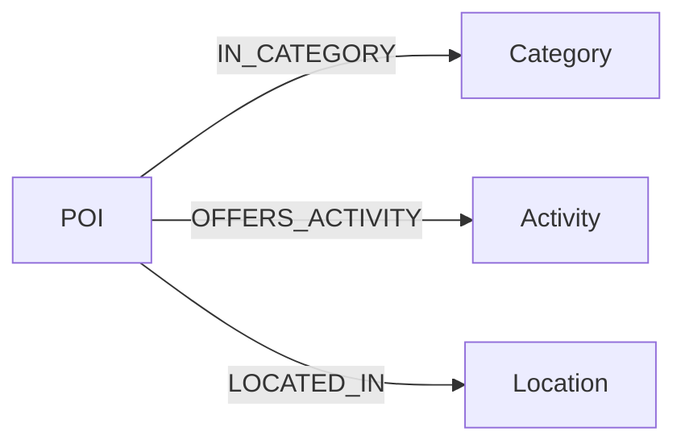

# GreenTrip AI Knowledge Graph

## Purpose

Neo4j stores a small semantic projection of GreenTrip POI facts for future
recommendation evidence and fact-based "Why this place?" explanations.
Supabase PostgreSQL/PostGIS remains the source of truth for POIs, coordinates,
users, itineraries, scores, and transactional data.

This design does not define a data import pipeline, recommendation algorithm,
or explanation generator.

## Repository and Data Findings

- A read-only `information_schema` check confirms that `public.pois.poi_id` is
  the non-null UUID primary key. The active POI repository reads this key, joins
  `public.poi_categories` and `public.cities`, and reads coordinates from a
  PostGIS `geom` column.
- `backend/migrations/001_create_pois.sql` documents an older flat schema with
  an identity `id`; it does not match the current repository/import contract.
  New graph integrations must use the current `poi_id`, not the legacy ID.
- The API POI model exposes ID, name, category, description, coordinates,
  address, and city.
- The processed dataset has 2,426 POIs, five controlled categories, and two
  semantic city codes: `DANANG` and `HUE`.
- The dataset includes `is_local_business` and `local_business_type`. Businesses
  are already represented as POIs, so a separate business node would duplicate
  the same entity.
- No normalized Activity or traveler-interest field exists yet. Activity facts
  must therefore come from an approved controlled mapping or later curated
  source; they must not be invented from free text during this design task.
- The raw OSM source records provider and ODbL license metadata. The curated
  enrichment also records its source. Current PostgreSQL import does not retain
  OSM IDs or cuisine, so those values cannot replace `poi_id` as graph identity.
- Existing Neo4j support consists of the Aura driver/configuration, application
  lifecycle handling, and a read-only connectivity query. No graph schema or
  Cypher data files existed before this task.

## Node Types

| Label | Purpose | Key property | Important properties |
| --- | --- | --- | --- |
| `POI` | Semantic projection of a PostgreSQL tourist place or business | `id` | `name`, `is_local_business`, optional `local_business_type`, optional `source` |
| `Category` | Controlled POI classification already represented relationally | `key` | `name` |
| `Activity` | Controlled traveler activity offered by a POI | `key` | `name` |
| `Location` | City-level semantic context, not a GIS replacement | `key` | `name`, `level` |

### POI property boundary

The graph keeps only identity and explanation-relevant properties. Full
descriptions, coordinates, addresses, opening hours, scores, costs, and route
data remain in PostgreSQL/PostGIS. `source` is an optional compact provenance
value such as `OpenStreetMap` or `curated`; no separate provenance ontology is
needed for the MVP.

### Controlled semantic keys

Current relational values can use these stable keys when a later sync task is
implemented:

| Current value | Graph key |
| --- | --- |
| `Ẩm thực và quán ăn` | `food_dining` |
| `Quán cafe giải khát` | `cafe_refreshment` |
| `Di tích lịch sử và văn hóa` | `historical_culture` |
| `Cảnh quan và thiên nhiên` | `nature_landscape` |
| `Tâm linh và chùa thiền` | `spiritual_temple` |
| Da Nang city | `DANANG` |
| Hue city | `HUE` |

Activity keys use the same machine-friendly convention, for example
`food_experience`, `cafe_experience`, `cultural_sightseeing`,
`nature_exploration`, and `spiritual_visit`. These examples define a candidate
controlled vocabulary, not automatically generated graph facts. A POI may offer
multiple activities once each relationship is supported by curated or approved
source data.

## Local and Community Businesses

A local business remains one `POI` node with `is_local_business = true` and an
optional `local_business_type`. There is no separate `CommunityBusiness` node
or duplicate representation in Phase 1. This directly supports the fact "this
POI supports local business exposure" while remaining faithful to the current
dataset.

## Relationships

| From | Relationship | To | Meaning |
| --- | --- | --- | --- |
| `POI` | `IN_CATEGORY` | `Category` | The POI has this controlled classification |
| `POI` | `OFFERS_ACTIVITY` | `Activity` | The POI supports this traveler activity |
| `POI` | `LOCATED_IN` | `Location` | The POI is semantically associated with this city |

All relationships point from the POI to the explanatory fact. No `NEAR`,
`SIMILAR_TO`, routing, score, or recommendation relationship is included.
Relationship properties are omitted because the current pipeline has no
reliable per-fact `source` or `confidence` values.

## Graph Diagram



## Identifier Mapping

The PostgreSQL UUID `public.pois.poi_id` value is authoritative. Its canonical text
form is stored unchanged as `POI.id`:

```text
PostgreSQL pois.poi_id -> toString(...) -> Neo4j POI.id
```

Application code must never use Neo4j internal element IDs as domain IDs.
`Category.key` uses a controlled machine key, `Activity.key` uses an approved
activity key, and `Location.key` uses the existing city code (`DANANG` or
`HUE`). Display names may change without changing those identities.

## Constraints and Indexes

`backend/neo4j/schema.cypher` defines uniqueness constraints for `POI.id`,
`Category.key`, `Activity.key`, and `Location.key`. Each constraint prevents
duplicate semantic entities and supplies index support for its key.

The only additional index is `poi_name_index` on `POI.name`, for optional name
lookup. Names are not unique. No separate key indexes are created because they
would duplicate indexes already owned by the uniqueness constraints.

## Example Graph

`backend/neo4j/sample_graph.cypher` contains three clearly marked sample POIs.
It is manual-only, is not connected to application startup, and must not be run
against production Aura. Its `sample:*` IDs cannot be confused with relational
POI UUIDs. The sample demonstrates shared Category, Activity, and Location nodes,
as well as a POI with multiple activities.

## Why-this-place Support

The graph returns facts, while a future application service turns those facts
into user-facing text. It can support evidence such as:

1. A POI is in the `historical_culture` category, offers
   `cultural_sightseeing`, and is located in `HUE`.
2. A POI is in the `nature_landscape` category and offers
   `nature_exploration` in `DANANG`.
3. A POI has `is_local_business = true`, is in the `food_dining` category, and
   offers a supported `food_experience` activity.

No full explanation sentence is stored in Neo4j.

## Explanation Fact Query

`backend/neo4j/queries/get_poi_explanation_facts.cypher` retrieves structured
graph facts that can support a future "Why this place?" feature. It accepts the
stable PostgreSQL UUID text as `$poi_id` and starts from the unique `POI.id`
property.

The relationship whitelist is `IN_CATEGORY`, `OFFERS_ACTIVITY`, and
`LOCATED_IN`. Each returned fact contains the relationship type plus the target
node type, stable key, and display name. The `poi` map also includes
`is_local_business`, `local_business_type`, and optional `source` properties.
This follows the approved local-business property model and does not invent a
business relationship or provenance value.

The query uses one controlled optional traversal and `collect(DISTINCT ...)`,
so multiple categories, activities, and locations do not multiply one another.
Facts are ordered by relationship type, target key, and target name. A POI with
no approved semantic relationships returns its `poi` map and an empty `facts`
list. An unknown `$poi_id` returns no rows, allowing a future backend layer to
map that result to its own not-found contract.

Run the query in Neo4j Browser with a placeholder application ID:

```cypher
:param poi_id => '00000000-0000-0000-0000-000000000000';
```

Then execute the contents of
`backend/neo4j/queries/get_poi_explanation_facts.cypher`. The query is
read-only, uses standard Cypher without APOC, and returns facts rather than
generating explanation prose.

## Naming Conventions

- Node labels: PascalCase (`POI`, `Category`, `Activity`, `Location`).
- Relationships: UPPER_SNAKE_CASE.
- Properties and machine keys: snake_case.
- Stable application keys are used instead of Neo4j internal IDs.

## Scope and Safety

- No `User` nodes or authentication data are modeled.
- No bulk POI import or synchronization is implemented.
- No recommendation, scoring, explanation, routing, or optimization logic is
  implemented.
- The schema contains no credentials and no destructive commands.
- Sample data is isolated in a manual file and is never run automatically.

## POI to Neo4j Import

### Purpose

`backend/scripts/import_pois_to_neo4j.py` reads the semantic POI projection
from PostgreSQL and idempotently merges it into the approved graph model. It
uses PostgreSQL `poi_id` UUID values as Neo4j `POI.id` values and does not copy
geometry, descriptions, scores, authentication data, or itinerary data.

The current PostgreSQL schema has no normalized activity field. The importer
therefore creates no `Activity` nodes or `OFFERS_ACTIVITY` relationships unless
an approved activity value is explicitly supplied by the source in the future.
It does not infer activities from category or free text.

### Prerequisites

1. Install `backend/requirements.txt`.
2. Configure `DATABASE_URL` and the existing `NEO4J_URI`, `NEO4J_USERNAME`,
   `NEO4J_PASSWORD`, and `NEO4J_DATABASE` environment variables.
3. Ensure Aura is reachable. Real credentials belong only in `.env`, Render
   secrets, or the local environment.

### Dry run

The dry run reads and validates PostgreSQL data without connecting to Neo4j:

```bash
python backend/scripts/import_pois_to_neo4j.py --dry-run
```

### Import a small sample

This safely applies the existing idempotent schema and merges three real POIs:

```bash
python backend/scripts/import_pois_to_neo4j.py --limit 3 --apply-schema
```

### Full import

```bash
python backend/scripts/import_pois_to_neo4j.py --apply-schema
```

The default write batch size is 250 and can be changed with `--batch-size`.
Without `--apply-schema`, the importer verifies that all four uniqueness
constraints already exist and stops before writing if any are missing.

### Validation

Use read-only Cypher after an import:

```cypher
MATCH (p:POI)
RETURN count(p) AS poi_count;
```

```cypher
MATCH (:POI)-[r]->()
RETURN type(r) AS relationship_type, count(r) AS relationship_count
ORDER BY relationship_type;
```

### Safety

- POI and semantic nodes use stable keys with `MERGE`.
- Relationships use `MERGE`, so repeated imports do not duplicate them.
- Cypher data is passed as parameters through `UNWIND $rows`.
- The importer never resets the graph or deletes stale data.
- `--dry-run` performs no Neo4j writes.
- No credentials are stored in the script or documentation.
