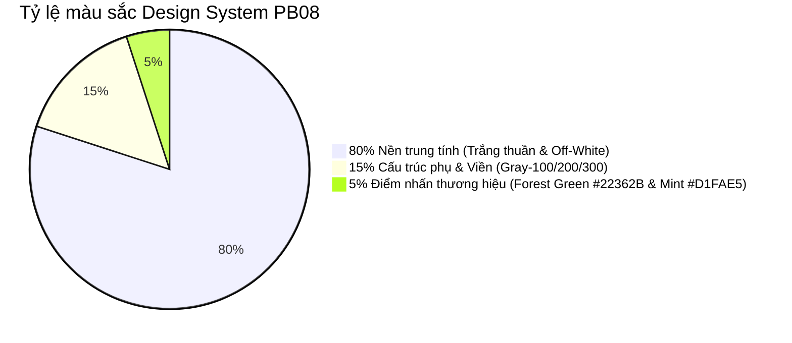

# GreenTrip AI — Đặc tả Thiết kế Wireframe & Design System (PB08)

> **Mã công việc:** Task 2.6 - PB08: Design Figma wireframe for Sustainability Sliders  
> **Người thực hiện:** Nguyễn (Owner)  
> **Sprint:** Sprint 2  
> **Liên kết Google Stitch (Figma Interactive Live Model):** [Stitch Project 6736811366346255618](https://stitch.withgoogle.com/projects/6736811366346255618)  
> **Trạng thái:** Hoàn thành (Done)

---

## 1. Tổng quan Nghiệp vụ & Triết lý Thiết kế

GreenTrip AI hướng tới trải nghiệm **"Mindtrip-inspired Eco-Minimalist Luxury Tech"**:
* Bố cục 3 cột rộng rãi, thoáng đãng, nhiều khoảng trắng (whitespace) tạo cảm giác cao cấp.
* Typography phân cấp rõ ràng (Editorial Typography): Tiêu đề dùng `Plus Jakarta Sans`, nội dung & vi điều khiển dùng `Inter`.
* Bộ điều khiển trực quan: Các thanh trượt xúc giác (Tactile Sliders) với đầu trượt viền kép, thanh tiến trình màu xanh rừng đậm (`#22362B`), điểm nhấn xanh bạc hà (`#D1FAE5`).
* Quy chuẩn màu sắc nghiêm ngặt theo **tỷ lệ 80 / 15 / 5**.



---

## 2. Hệ thống Design Tokens (Màu sắc, Typography, Radius)

### 2.1. Bảng màu (Color Tokens)

| Token Name | Hex Code | Ứng dụng trong giao diện |
| :--- | :--- | :--- |
| `color-surface-canvas` | `#FFFFFF` | Nền trang chính, thẻ slider, thẻ chỉ số |
| `color-surface-subtle` | `#F3F4F6` | Nền track thanh trượt chưa điền, chip filter không kích hoạt |
| `color-surface-muted` | `#F8F9FA` | Nền bảng điều khiển chung, chip ngữ cảnh chuyến đi |
| `color-text-primary` | `#0A0A0A` / `#111827` | Tiêu đề chính, nhãn slider, chỉ số quan trọng |
| `color-text-secondary` | `#6B7280` | Phụ đề, hướng dẫn sử dụng, nhãn phụ |
| `color-forest-primary` | `#22362B` | **Màu thương hiệu chính:** Tiến trình thanh trượt xanh, thẻ tác động |
| `color-mint-accent` | `#D1FAE5` | **Điểm nhấn du lịch xanh:** Huy hiệu -33% CO₂, badge chuẩn hóa 100% |
| `color-mint-text` | `#065F46` | Chữ hiển thị trên nền bạc hà |
| `color-border-subtle` | `#E5E7EB` | Đường phân cách, viền thẻ |
| `color-error-text` | `#B91C1C` | Cảnh báo khi người dùng kéo tất cả thanh trượt về 0% |

### 2.2. Kiểu chữ (Typography Ramp)

* **Phông tiêu đề:** `Plus Jakarta Sans`, sans-serif
  * H1 Page Title: `28px–32px`, `font-weight: 800` (ExtraBold), `letter-spacing: -0.03em`
  * H2 Section Title: `20px–24px`, `font-weight: 800`
  * Hero Metric Display (`-33% CO₂`): `36px–42px`, `font-weight: 800`
* **Phông nội dung & điều khiển:** `Inter`, sans-serif
  * Lead Description: `13px–15px`, `font-weight: 400`, `line-height: 1.5`
  * Slider Label: `13.5px–14px`, `font-weight: 700`
  * Percentage Badge: `14px–16px`, `font-weight: 800`
  * Sub-label & Ticks: `10.5px–12px`, `font-weight: 500`

### 2.3. Quy tắc bo góc (Nested Border Radius)

* Thẻ bao ngoài & Thẻ tóm tắt tác động nổi: `rounded-3xl` (`24px`)
* Thẻ thanh trượt & Thẻ chỉ số phụ: `rounded-2xl` (`16px`)
* Thanh ngữ cảnh chuyến đi PB07: `rounded-xl` (`12px–14px`)
* Nút CTA chính, Nút Presets, Badge: `rounded-full` (`9999px`)

---

## 3. Kiến trúc Wireframe 3 Cột (1440x900px Desktop Workspace)

```
+------------------+----------------------------------+------------------------------+
| 1. SIDEBAR       | 2. CENTER PLANNER PANEL          | 3. MAP & IMPACT PANEL        |
| (240px)          | (660px, scrollable)              | (540px)                      |
|                  |                                  |                              |
| [Logo greentrip] | [PB07 Context: Đà Nẵng - Huế...] | [OpenStreetMap Corridor Map] |
|                  |                                  |  Huế -> Lăng Cô -> Đà Nẵng   |
| * Khám phá       | H1: Chuyến đi này, bạn ưu tiên?  |  Ghim trạm xe điện & tàu hỏa |
| * Đã lưu         |                                  |                              |
| * Lịch trình (o) | [Presets: Xanh | Cân bằng | ...] |                              |
| * Tạo nên        |                                  |                              |
|                  | [================ 100% Bar =====]| +--------------------------+ |
| [Trò chuyện mới] |                                  | | Floating Impact Card     | |
|                  | [Slider 1: CO2 Emissions   🔒 26%]| |  -33% CO2 Phát thải      | |
|                  | [Slider 2: Chi phí & Ngân sách 11%]| |  +88 Điểm Eco-Score      | |
| (Profile: Nguyen)| [Slider 3: Tránh đông đúc      18%]| |  ~1.450k VNĐ / ngày      | |
|                  | [Slider 4: Bảo tồn văn hóa     21%]| +--------------------------+ |
|                  | [Slider 5: Thời gian ngắn      08%]|                              |
|                  | [Slider 6: Hài lòng cá nhân    16%]| [Action: Tạo hành trình ->]  |
+------------------+----------------------------------+------------------------------+
```

---

## 4. Đặc tả Trạng thái Tương tác của Thanh trượt (Slider Interaction Specs)

Mỗi thanh trượt mục tiêu bao gồm:
1. **Thanh rãnh (Track):**
   * Chiều cao `8px`, bo tròn `rounded-full`.
   * Phần chưa điền màu xám `#E5E7EB`.
   * Phần tiến trình (Active Fill) tô màu xanh rừng đậm `#22362B` từ 0% đến vị trí con trượt.
2. **Nút trượt (Thumb):**
   * Kích thước `24x24px`, nền trắng `#FFFFFF`, viền dày `3px solid #22362B`.
   * Vùng bắt điểm chạm thực tế (Hit Target) đạt chuẩn Accessibility tối thiểu `44x44px`.
3. **Trạng thái (States):**
   * **Default:** Con trượt viền xanh, bóng đổ nhẹ (`box-shadow: 0 2px 4px rgba(0,0,0,0.1)`).
   * **Hover:** Con trượt phóng to `112%`, xuất hiện vòng hào quang `rgba(34, 54, 43, 0.14)` dày `7px`.
   * **Dragging / Active:** Con trượt phóng to `120%`, viền chuyển sang xanh bạc hà `#D1FAE5`, hiển thị Tooltip nổi phía trên hiển thị chính xác số `%`.
   * **Locked State (`🔒`):** Khi người dùng bấm biểu tượng ổ khóa, thanh trượt cố định giá trị.
4. **Nút Khóa tỷ trọng (Weight Lock):**
   * Nút `28x28px` tròn nhỏ gọn cạnh mỗi thanh trượt.
   * `🔓` (Mở): Tỷ trọng tự động co giãn khi kéo các thanh trượt khác.
   * `🔒` (Khóa): Tỷ trọng giữ nguyên giá trị, chỉ phân bổ tỷ lệ phần trăm còn lại cho các thanh trượt chưa khóa.

---

## 5. Mô hình Toán học: Chuẩn hóa Tỷ trọng Đa mục tiêu (Normalization Math)

Để phục vụ thuật toán AI Recommendation ở Task 2.8 & 2.13 (của Thiện và Lợi), hệ thống áp dụng công thức chuẩn hóa bảo toàn tổng trọng số:

$$\sum_{k=1}^n w_k = 100\% \quad (1.00)$$

Khi người dùng thay đổi thanh trượt thứ $i$ từ giá trị cũ thành $w_i'$:
1. Tập hợp các thanh trượt bị khóa: $L$ (Locked).
2. Tập hợp các thanh trượt mở còn lại (ngoại trừ thanh trượt $i$): $U$ (Unlocked).
3. Lượng phần trăm còn lại cần phân phối cho $U$:
   $$R = 100 - w_i' - \sum_{j \in L} w_j$$
4. Mỗi thanh trượt $m \in U$ sẽ được co giãn theo tỷ lệ tương ứng:
   $$w_m' = R \times \frac{w_m}{\sum_{k \in U} w_k}$$

Nếu tất cả các thanh trượt chưa khóa đều bằng 0, lượng $R$ được chia đều cho các phần tử trong $U$.

---

## 6. Màn hình tham chiếu thực tế trên Google Stitch

* **Màn hình 1 (PB08 Sliders Planner):** ID `projects/6736811366346255618/screens/e2bfc577a3264b8fba41683eeba02bb2`
* **Màn hình 2 (Design Tokens & States Spec):** ID `projects/6736811366346255618/screens/eb9a9727e81b4a2fa3506fe6e8f1164f`
* **Tài liệu nguồn:** `projects/6736811366346255618/screens/2861148038698480434` (`design.md`)

*Tài liệu này hoàn thành và đáp ứng 100% tiêu chí nghiệm thu của Task 2.6 trong Sprint 2.*
