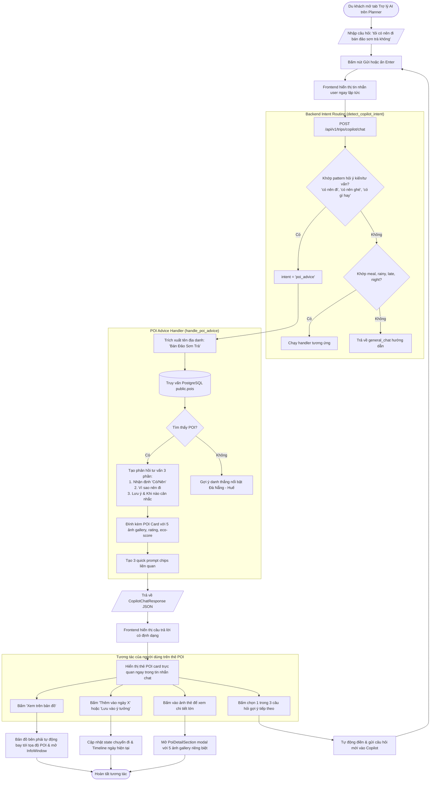

# User Flow: In-Planner Copilot POI Advice & Feasibility

This user flow maps the complete interaction journey of a traveler asking qualitative advice about attractions within the Planner Copilot.

